# RoboticsCore

Classical robotics algorithms in modern C++: estimation, mapping, SLAM, planning, trajectory
generation and control. Each one is implemented from first principles, tested and documented,
and benchmarked where a fair comparison exists.

[](LICENSE)


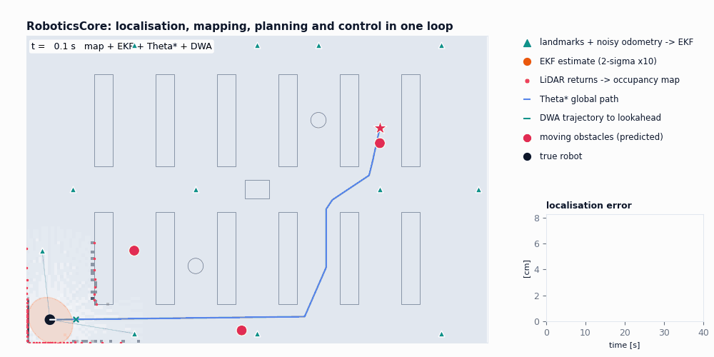

*A simulated differential-drive robot crosses a warehouse. It plans a global path with
Theta*, avoids three moving obstacles with the Dynamic Window Approach, localises with an EKF
against range-bearing landmarks, and builds an occupancy grid from LiDAR. Reproduce it with
`python scripts/render/render_hero.py`.*

## Why this library

- **Readable, complete implementations.** Each algorithm is a small, self-contained unit with a
  documented mathematical formulation, its assumptions and its known failure modes. There are
  no wrappers around other solvers.
- **Verified.** 256 GoogleTest cases cover four suites:
  - unit tests;
  - numerical tests: finite-difference Jacobians, Lie-group identities, filter consistency;
  - closed-loop integration tests;
  - regression tests with golden values.
- **Clean builds.** Builds are warning-free with MSVC `/W4 /WX` and with clang `-Wall -Wextra -Werror`.
  The test suites also pass under AddressSanitizer and UndefinedBehaviorSanitizer, and the code
  is clean under clang-tidy.
- **Reproducible.** Every stochastic component takes an explicitly seeded generator with
  portable distributions. Benchmarks and animations record the seed, configuration and commit
  that produced them.
- **Measured.** The benchmark tables are produced by the code in this repository. Nothing is
  estimated or copied from papers.
- **Small footprint.** The library's only dependency is Eigen. It is split into modules
  (`RoboticsCore::planning`, `RoboticsCore::control`, ...) so users link only what they need.

## Gallery

| | | |
|:---:|:---:|:---:|
| 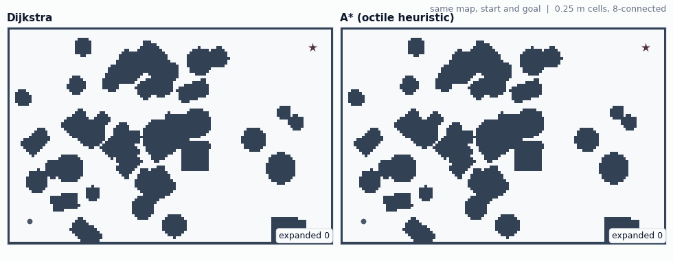 | 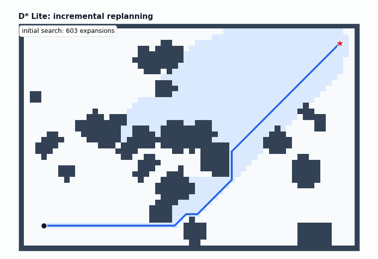 | 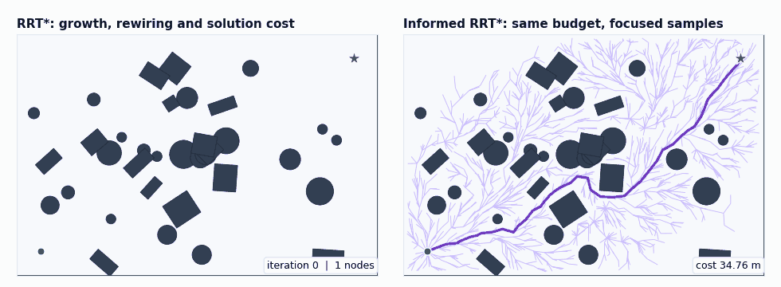 |
| [Dijkstra vs A*, Theta*](docs/algorithms/planning/grid_search.md) | [D* Lite replanning](docs/algorithms/planning/dstar_lite.md) | [RRT* and Informed RRT*](docs/algorithms/planning/sampling_planners.md) |
| 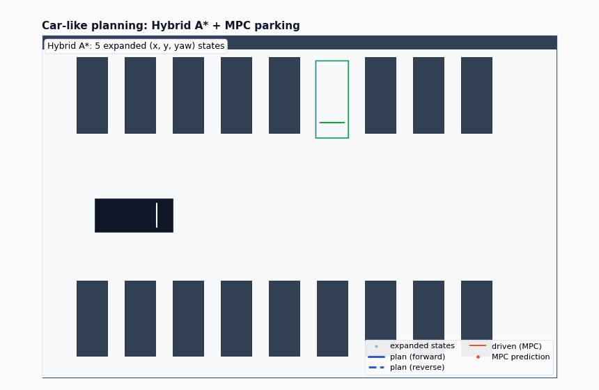 | 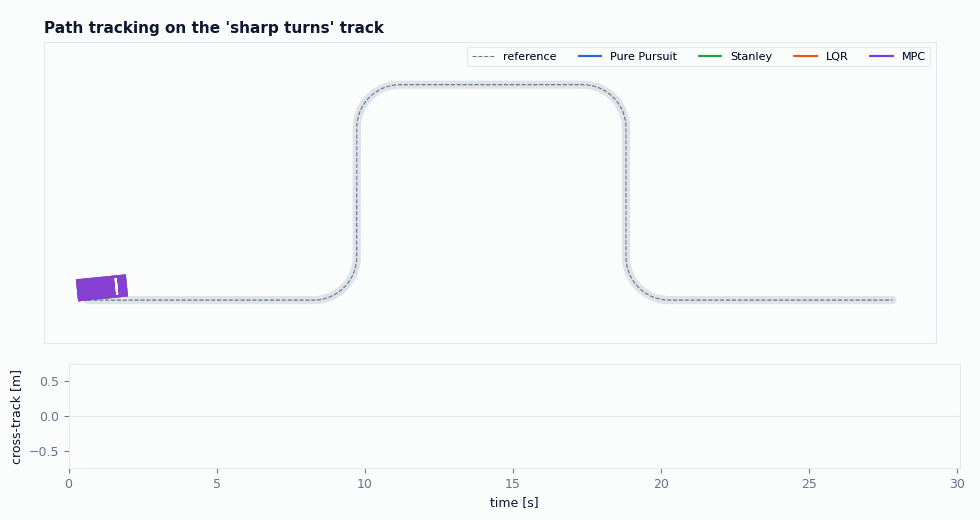 | 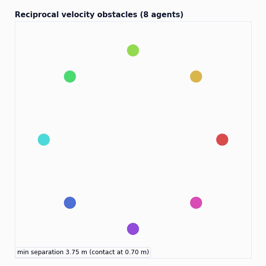 |
| [Hybrid A* parking + MPC](docs/algorithms/planning/hybrid_astar.md) | [Pure Pursuit, Stanley, LQR, MPC](docs/algorithms/control/geometric_trackers.md) | [Reciprocal velocity obstacles](docs/algorithms/planning/local_planners.md) |
| 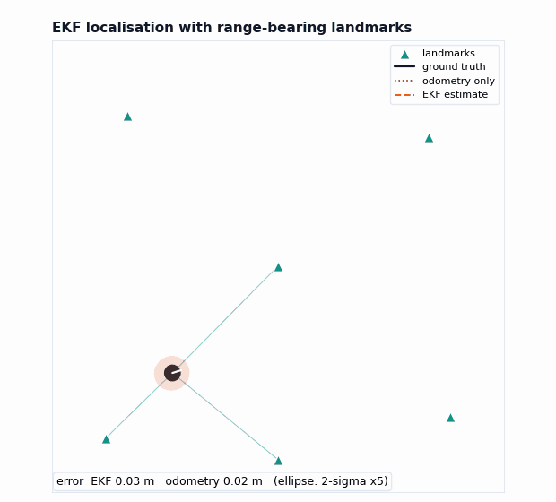 | 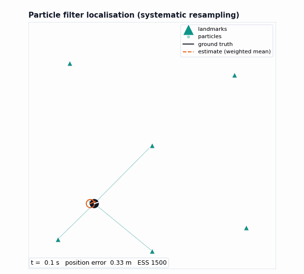 | 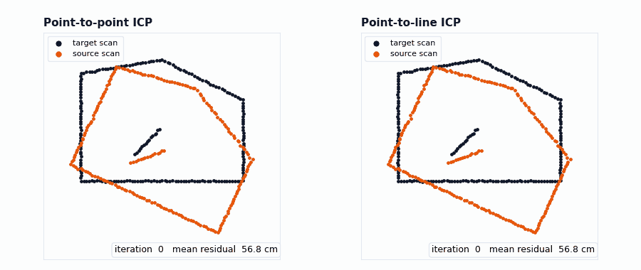 |
| [EKF localisation](docs/algorithms/estimation/ekf.md) | [Particle filter localisation](docs/algorithms/estimation/particle_filter.md) | [Point-to-point vs point-to-line ICP](docs/algorithms/mapping/icp.md) |
| 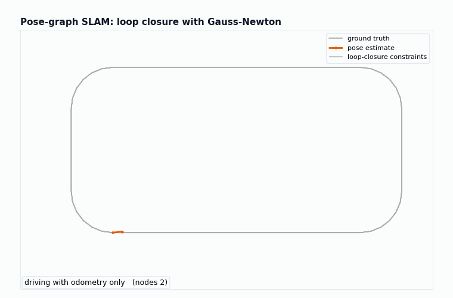 | 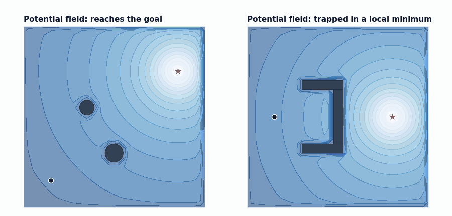 | |
| [Pose-graph SLAM loop closure](docs/algorithms/slam/pose_graph.md) | [Potential fields and local minima](docs/algorithms/planning/local_planners.md) | |

Every animation is rendered from a JSON trace written by the C++ demo executable.
[`docs/assets/manifest.json`](docs/assets/manifest.json) lists the demo, seed, configuration
and commit behind each one.

## What is implemented

<!-- status:begin -->
| Area | Algorithm | Status | Tests | Demo | Benchmark |
|---|---|---|---:|---|---|
| Math and geometry | [SO(2), SE(2), SO(3), SE(3) Lie groups](docs/mathematics/lie_groups.md) | Tested | 3 | - | micro |
|  | [Angles, interpolation, integration, statistics, portable RNG](docs/mathematics/numerical_methods.md) | Tested | 4 | - | - |
|  | [Collision primitives and 2D environment](docs/algorithms/geometry/collision_and_spatial.md) | Tested | 1 | - | - |
|  | [k-d tree (nearest, k-nearest, radius)](docs/algorithms/geometry/collision_and_spatial.md) | Tested | 1 | - | micro |
| Motion models | [Unicycle and differential drive](docs/algorithms/models/motion_models.md) | Tested | 1 | - | - |
|  | [Kinematic bicycle and Ackermann geometry](docs/algorithms/models/motion_models.md) | Tested | 1 | - | - |
|  | [Double integrator](docs/algorithms/models/motion_models.md) | Tested | 1 | - | - |
| State estimation | [Kalman filter (Joseph form)](docs/algorithms/estimation/kalman_filter.md) | Tested | 2 | - | - |
|  | [Extended Kalman filter](docs/algorithms/estimation/ekf.md) | Tested | 1 | [ekf_localization](docs/assets/ekf_localization.gif) | [scenario](docs/benchmarks/README.md) |
|  | [Unscented Kalman filter](docs/algorithms/estimation/ukf.md) | Tested | 1 | - | [scenario](docs/benchmarks/README.md) |
|  | [Particle filter (multinomial, stratified, systematic, residual resampling)](docs/algorithms/estimation/particle_filter.md) | Tested | 1 | [particle_filter](docs/assets/particle_filter.gif) | [scenario](docs/benchmarks/README.md) |
|  | [NEES / NIS consistency and chi-square gating](docs/algorithms/estimation/kalman_filter.md) | Tested | 1 | - | [scenario](docs/benchmarks/README.md) |
| Mapping and registration | [Occupancy grid mapping (log-odds)](docs/algorithms/mapping/occupancy_grid.md) | Tested | 1 | [hero](docs/assets/hero.gif) | - |
|  | [Bresenham and Amanatides-Woo grid ray casting](docs/algorithms/mapping/occupancy_grid.md) | Tested | 1 | - | - |
|  | [ICP (point-to-point, point-to-line)](docs/algorithms/mapping/icp.md) | Tested | 1 | [icp](docs/assets/icp.gif) | micro |
| SLAM | [EKF-SLAM](docs/algorithms/slam/ekf_slam.md) | Tested | 1 | - | [scenario](docs/benchmarks/README.md) |
|  | [FastSLAM 1.0 (known data association)](docs/algorithms/slam/fastslam.md) | Tested | 1 | - | [scenario](docs/benchmarks/README.md) |
|  | [Pose-graph SLAM (sparse Gauss-Newton / Levenberg-Marquardt)](docs/algorithms/slam/pose_graph.md) | Tested | 1 | [pose_graph](docs/assets/pose_graph.gif) | [scenario](docs/benchmarks/README.md) |
| Planning | [BFS, Dijkstra, A*, weighted A*](docs/algorithms/planning/grid_search.md) | Tested | 2 | [astar](docs/assets/astar.gif) | [scenario](docs/benchmarks/README.md) |
|  | [Theta* (any-angle)](docs/algorithms/planning/grid_search.md) | Tested | 2 | [astar](docs/assets/astar.gif) | [scenario](docs/benchmarks/README.md) |
|  | [D* Lite (incremental replanning)](docs/algorithms/planning/dstar_lite.md) | Tested | 2 | [dstar_lite](docs/assets/dstar_lite.gif) | - |
|  | [PRM, RRT, RRT-Connect](docs/algorithms/planning/sampling_planners.md) | Tested | 1 | - | [scenario](docs/benchmarks/README.md) |
|  | [RRT*, Informed RRT*](docs/algorithms/planning/sampling_planners.md) | Tested | 1 | [rrt_star](docs/assets/rrt_star.gif) | [scenario](docs/benchmarks/README.md) |
|  | [Reeds-Shepp curves](docs/algorithms/planning/hybrid_astar.md) | Tested | 2 | - | micro |
|  | [Hybrid A*](docs/algorithms/planning/hybrid_astar.md) | Tested | 2 | [parking](docs/assets/parking.gif) | - |
|  | [Path smoothing (shortcut, gradient, resampling)](docs/algorithms/planning/path_smoothing.md) | Tested | 1 | - | - |
|  | [Dynamic Window Approach](docs/algorithms/planning/local_planners.md) | Tested | 2 | [hero](docs/assets/hero.gif) | - |
|  | [Artificial potential fields](docs/algorithms/planning/local_planners.md) | Tested | 1 | [potential_field](docs/assets/potential_field.gif) | - |
|  | [Velocity obstacles / reciprocal velocity obstacles](docs/algorithms/planning/local_planners.md) | Tested | 1 | [rvo](docs/assets/rvo.gif) | - |
|  | ORCA (optimal reciprocal collision avoidance) | Planned | - | - | - |
| Trajectories and optimisation | [Cubic / quintic polynomials, trapezoidal profile](docs/algorithms/trajectory/trajectories.md) | Tested | 2 | - | - |
|  | [Cubic splines, B-splines, Bezier curves](docs/algorithms/trajectory/trajectories.md) | Tested | 1 | - | - |
|  | [Speed profiles and reference paths](docs/algorithms/trajectory/trajectories.md) | Tested | 1 | [controllers](docs/assets/controllers.gif) | - |
|  | [Gauss-Newton and Levenberg-Marquardt](docs/algorithms/optimization/least_squares_and_qp.md) | Tested | 1 | - | - |
|  | [ADMM quadratic programming (OSQP-style iteration)](docs/algorithms/optimization/least_squares_and_qp.md) | Tested | 1 | - | - |
| Control | [PID with anti-windup](docs/algorithms/control/pid.md) | Tested | 1 | - | - |
|  | [Pure Pursuit and Stanley](docs/algorithms/control/geometric_trackers.md) | Tested | 2 | [controllers](docs/assets/controllers.gif) | [scenario](docs/benchmarks/README.md) |
|  | [LQR (discrete Riccati equation, path tracking)](docs/algorithms/control/lqr.md) | Tested | 2 | [controllers](docs/assets/controllers.gif) | [scenario](docs/benchmarks/README.md) |
|  | [Linear time-varying MPC](docs/algorithms/control/mpc.md) | Tested | 2 | [parking](docs/assets/parking.gif) | [scenario](docs/benchmarks/README.md) |
| Simulation and integration | [Deterministic 2D simulator, sensors and scenarios](docs/architecture.md) | Tested | 2 | [hero](docs/assets/hero.gif) | [scenario](docs/benchmarks/README.md) |
|  | [ROS 2 adapter package](ros2/roboticscore_ros/README.md) | Experimental | - | - | - |
|  | Python bindings (pybind11) | Planned | - | - | - |

*Tested*: implemented, unit tested and documented. *Experimental*: implemented, limited validation. *Planned*: not implemented. Tests = number of test files covering the entry. Generated from [`configs/algorithms.yaml`](configs/algorithms.yaml) by `scripts/docs/generate_status.py`.
<!-- status:end -->

## Quick start

```bash
cmake --preset release
cmake --build --preset release
ctest --preset release
```

On Windows, run `call scripts\setup\vs_env.cmd` first to load the Visual Studio toolchain. To
use the library from your own project:

```cmake
find_package(RoboticsCore 0.1 CONFIG REQUIRED)
target_link_libraries(my_robot PRIVATE RoboticsCore::planning RoboticsCore::control)
```

```cpp
#include "roboticscore/planning/grid/grid_search.hpp"

using namespace roboticscore;

planning::GridMap map(geometry::GridSpec(40, 30, 0.5));    // 40 x 30 cells, 0.5 m
for (int y = 0; y < 22; ++y) map.set_blocked({20, y}, true);
const planning::GridPath plan = planning::astar(map, {2, 2}, {37, 3});
if (plan.found()) { /* plan.cells, plan.cost (m), plan.expanded */ }
```

The [getting-started guide](docs/getting_started.md) covers build options, installing,
demos and rendering. [`examples/external_project`](examples/external_project) is a complete
downstream project that plans with A* and tracks the path with Pure Pursuit.

## Benchmarks

The following numbers are excerpts from [docs/benchmarks/README.md](docs/benchmarks/README.md).
They were measured on an Intel Core i5-1335U under Windows 11 with an MSVC Release build. The
full report lists all scenarios and the exact setup.

| Question | Result |
|---|---|
| How much does the heuristic save? (cluttered map, 8-connected) | A* expands 1,520 nodes vs Dijkstra's 6,490, with the same 34.30 m path. Theta* finds a 32.73 m any-angle path. |
| Do sampling planners solve the narrow passage? (20 seeds) | RRT, RRT-Connect, RRT* and Informed RRT* succeed in all runs. PRM with 600 milestones succeeds in 75%. |
| Is the EKF consistent? (low noise, 20 seeds) | Mean NEES 3.05 (expected 3) and mean NIS 1.99 (expected 2). |
| What does a chi-square gate buy under 5% outliers? | EKF position RMSE drops from 0.371 m to 0.017 m, and mean NEES from 2,739.77 to 3.32. |
| How much does loop closure help? (pose graph, two laps) | ATE drops from 1.128 m (odometry only) to 0.178 m. |
| Which tracker follows sharp turns best? (cross-track RMSE) | Stanley 0.014 m, LQR 0.027 m, MPC 0.051 m, Pure Pursuit 0.153 m. The ranking changes with the track; see the report. |

Reproduce with `python scripts/benchmark/run_benchmarks.py` on a Release build.

## Architecture

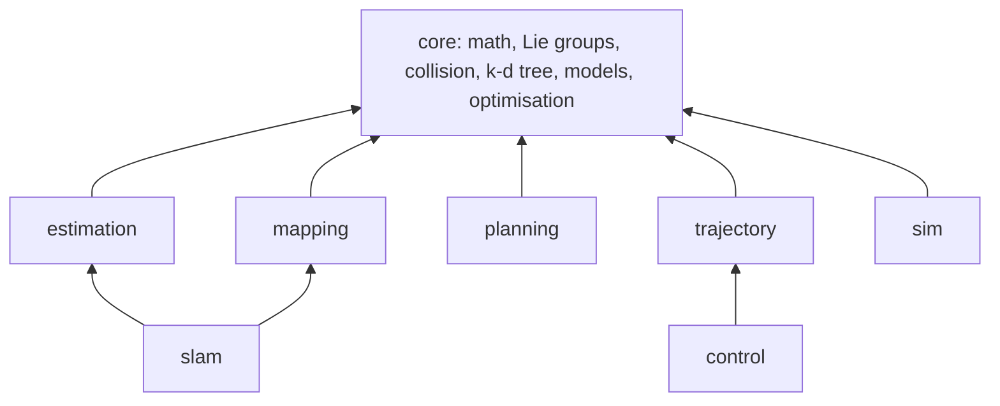

Each module is a static library exported as `RoboticsCore::<module>`, and
`RoboticsCore::RoboticsCore` links them all. Errors follow one policy:

- contract violations throw `std::invalid_argument`;
- numerical breakdowns throw `NumericalError`;
- expected outcomes, such as "no path", are reported as a status in a result struct.

See [docs/architecture.md](docs/architecture.md) and the
[architecture decision records](docs/adr/README.md).

```text
include/roboticscore/   public headers          tests/       unit, numerical, integration, regression
src/                    implementation          benchmarks/  Google Benchmark microbenchmarks
apps/                   demos, pipelines, bench python/      trace rendering and reports
docs/                   algorithm pages, ADRs   ros2/        optional ROS 2 adapter package
```

## Documentation

- [Algorithm pages](docs/README.md). Each page gives the formulation, assumptions, algorithm,
  complexity, configuration, an example, benchmark results, limitations and references.
- [Lie groups](docs/mathematics/lie_groups.md) and
  [numerical methods](docs/mathematics/numerical_methods.md).
- API reference: Doxygen comments in the public headers (`doxygen docs/Doxyfile`).

## ROS 2

[`ros2/roboticscore_ros`](ros2/roboticscore_ros) is an optional `ament_cmake` package. It
consumes the installed library and exposes selected algorithms as ROS 2 nodes. The core
library does not depend on ROS ([ADR 0007](docs/adr/0007-ros2-adapter.md)). The adapter is
**experimental**; its README states what has been verified.

## Limitations

- The scope is 2D: planar robots, 2D maps and 2D scan registration. SO(3) and SE(3) are
  available as math utilities, but there are no 3D planners or 3D SLAM.
- The models are kinematic: no tyre dynamics, slip or actuator dynamics. The controllers were
  evaluated in simulation only.
- The SLAM implementations assume known data association. FastSLAM is version 1.0, and EKF-SLAM
  uses a dense update that costs O(N³) per observation in the number of landmarks N.
- The QP and sparse least-squares solvers are compact internal implementations. For large
  problems they are not substitutes for OSQP, Ceres or g2o.
- The test matrix has been verified on Windows with MSVC and clang. Linux with GCC is
  configured through presets but is not yet part of the verified matrix.
- Timings are specific to the machine they were measured on and say nothing about real-time
  guarantees.

## Roadmap

- Linux and GCC in the verified CI matrix, with coverage reporting.
- ORCA alongside RVO.
- Python bindings with pybind11.
- Verification of the ROS 2 adapter against a ROS 2 distribution in CI.

## Contributing

Contributions are welcome. See [CONTRIBUTING.md](CONTRIBUTING.md) for the workflow and coding
standards, and [SECURITY.md](SECURITY.md) for how to report vulnerabilities.
[CHANGELOG.md](CHANGELOG.md) records released changes, and [PROJECT_STATUS.md](PROJECT_STATUS.md)
summarises the current state.

## License

[MIT](LICENSE). The dependencies have their own licenses; see
[ADR 0003](docs/adr/0003-dependencies.md).
