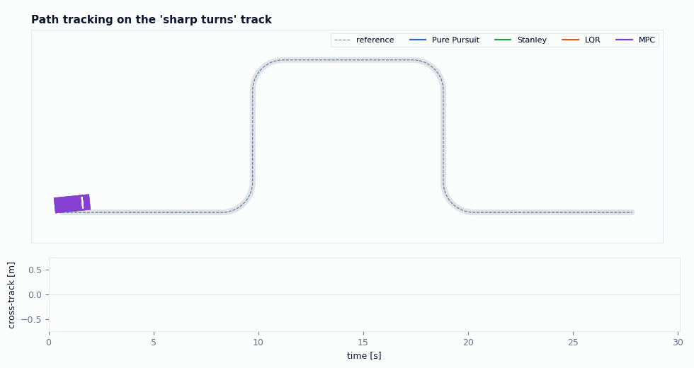

# Geometric path trackers: Pure Pursuit and Stanley

Headers: [`include/roboticscore/control/geometric_trackers.hpp`](../../../include/roboticscore/control/geometric_trackers.hpp), [`include/roboticscore/control/path_tracking.hpp`](../../../include/roboticscore/control/path_tracking.hpp) · source: [`src/control/geometric_trackers.cpp`](../../../src/control/geometric_trackers.cpp)

## Purpose

`PurePursuitTracker` and `StanleyTracker` compute a steering angle from the geometry of a
`trajectory::ReferencePath` relative to a car-like vehicle, and an acceleration from a PID
speed loop. They are cheap, have few parameters and are the usual baseline for
forward-driving path tracking.

## Mathematical formulation

Common conventions (`path_tracking.hpp`):

- State $(x, y, \psi, v)$ of the kinematic bicycle at the **rear axle**, wheelbase $L$.
- Reference path samples carry the vehicle yaw as heading, the curvature $\tan\delta / L$ and a
  **signed** reference speed (negative = reverse).
- Cross-track error $e$ is positive when the tracked point is left of the path; the heading error
  reported in `status()` is $\psi - \psi_{\mathrm{path}}$.
- Speed loop: $a = \mathrm{PID}(v_{\mathrm{ref}}(s + \texttt{kSpeedPreview}),\ v)$ with
  `kSpeedPreview` $= 0.5$ m; the preview keeps rest-to-rest profiles (zero speed at $s = 0$)
  from stalling the vehicle.
- The path is finished when the projection satisfies $s \ge \ell_{\mathrm{path}} - d_{\mathrm{fin}}$,
  with $d_{\mathrm{fin}}$ = `kFinishTolerance` $= 0.3$ m.
- Steering is clamped to $\pm\delta_{\max}$.

### Pure Pursuit

The rear axle $p_r$ is projected onto the path (arc length $s_r$). The lookahead is an arc-length
offset

$$
L_d = \mathrm{clamp}(k_v \lvert v \rvert + L_0,\ L_{\min},\ L_{\max}),
$$

the target is $p_t = p(s_r + L_d)$ (clamped to the path end), and with $d = p_t - p_r$,
$\ell = \max(\lVert d \rVert, 10^{-6})$ and target bearing $\alpha = \mathrm{wrap}(\mathrm{atan2}(d_y, d_x) - \psi)$,
the circular arc through the target gives curvature $\kappa = 2\sin\alpha / \ell$ and

$$
\delta = \arctan\frac{2 L \sin\alpha}{\ell}.
$$

Note that the steering law divides by the Euclidean distance $\ell$ to the target, which equals
$L_d$ only when the vehicle is on a straight path.

### Stanley

The front axle $p_f = p_r + L(\cos\psi, \sin\psi)$ is projected onto the path, giving the
cross-track error $e$, path heading $\psi_{\mathrm{path}}$ and curvature $\kappa$ at the front-axle
projection. With $\theta_e = \psi_{\mathrm{path}} - \psi$ (the opposite sign of `status().heading_error`):

$$
\delta = \mathrm{wrap}\Big(\theta_e + \arctan\frac{-k\,e}{k_{\mathrm{soft}} + \lvert v \rvert} \;[+ \arctan(L\kappa)]\Big).
$$

The bracketed curvature feedforward is optional and not part of the original paper.

## Assumptions

- Kinematic bicycle without tyre slip; steering acts instantaneously.
- Forward driving ($v \ge 0$). Neither law handles reverse segments; use
  [LQR](lqr.md) or [MPC](mpc.md) for paths with cusps.
- The path is densely sampled with continuous heading; Stanley additionally relies on
  meaningful path heading at the front-axle projection.

## Algorithm

Per call of `compute(state, path, dt)`:

1. Project the tracked point (rear axle for Pure Pursuit, front axle for Stanley) onto the path,
   searching only $\pm 50$ segments around the previous projection (global search on the first
   call or after `reset()`); fill `status()`.
2. Evaluate the steering law above and clamp it.
3. Run the PID speed loop towards the previewed reference speed.

## Implementation notes

- For Stanley, every `status()` quantity (cross-track and heading error, reference speed,
  `path_s`, `finished`) refers to the **front axle**; for Pure Pursuit it refers to the rear
  axle. `status().target` is the lookahead point (Pure Pursuit) or the front-axle projection
  (Stanley).
- `PurePursuitTracker::last_lookahead()` returns the clamped $L_d$ of the last step.
- The signed reference speed is tracked by the PID loop, but the steering laws assume forward
  motion.
- Both trackers derive from `PathTracker`, so they can be used through
  `std::unique_ptr<PathTracker>` alongside LQR and MPC.

## Complexity

$O(w)$ per step for the windowed projection ($w = 50$ segments each side) plus $O(\log n)$ for
the arc-length lookup of the target and speed preview; $O(n)$ for the first, unhinted
projection. No allocation in steady state.

## Configuration

| `PurePursuitConfig` field | Default | Meaning |
|---|---|---|
| `lookahead_gain` | `0.5` s | $k_v$ |
| `lookahead_min` | `2.0` m | $L_{\min}$ |
| `lookahead_max` | `15.0` m | $L_{\max}$ |
| `lookahead_offset` | `1.5` m | $L_0$ |
| `speed_pid` | `{1.5, 0.3, 0.0, -3.0, 3.0, 0.0, kClamping, 1.0}` | speed loop, see [PID](pid.md) |

| `StanleyConfig` field | Default | Meaning |
|---|---|---|
| `gain` | `1.5` 1/s | $k$ |
| `softening` | `1.0` m/s | $k_{\mathrm{soft}}$ (must be $> 0$) |
| `curvature_feedforward` | `false` | add $\arctan(L\kappa)$ |
| `speed_pid` | as above | speed loop |

Vehicle limits come from `models::BicycleParams` (wheelbase, `max_steer`).

## Example

```cpp
#include "roboticscore/control/geometric_trackers.hpp"
#include "roboticscore/trajectory/tracks.hpp"

using namespace roboticscore;

auto path = trajectory::make_track(trajectory::TrackType::kSCurve, 5.0);
path.apply_speed_profile(6.0, 1.5, 2.0);           // v_max, a_max, a_lat_max
const models::BicycleParams car{2.7, 0.6, 10.0, 3.0};
const models::KinematicBicycle model(car);
control::StanleyTracker tracker(car);              // or control::PurePursuitTracker(car)

models::BicycleState x(0.0, 1.0, 0.1, 0.0);        // rear axle (x, y, yaw, v)
const double dt = 0.05;
for (int k = 0; k < 3000 && !tracker.status().finished; ++k) {
  const control::VehicleCommand u = tracker.compute(x, path, dt);
  x = model.step(x, models::BicycleInput(u.acceleration, u.steering), dt);
}
```



Pure Pursuit, Stanley, LQR and MPC on one track. Render with
`python scripts/render/render_controllers.py`.

## Benchmark

From [`docs/benchmarks/README.md`](../../benchmarks/README.md) (kinematic bicycle, wheelbase
2.7 m, $\lvert\delta\rvert \le 0.6$ rad, 20 Hz, speed profile limited to 6 m/s, 1.5 m/s²,
2 m/s² lateral; errors exclude the first 2 s):

| Track | Pure Pursuit cross-track RMSE / max [m] | Stanley cross-track RMSE / max [m] | Compute PP / Stanley [us/step] |
|---|---:|---:|---:|
| circle | 1.7e-04 / 4.1e-04 | 0.005 / 0.031 | 0.7 / 0.7 |
| s curve | 0.110 / 0.199 | 0.013 / 0.022 | 0.6 / 0.6 |
| sharp turns | 0.153 / 0.348 | 0.014 / 0.034 | 0.6 / 0.6 |
| variable curvature | 0.098 / 0.199 | 0.011 / 0.022 | 0.6 / 0.6 |

The Stanley errors are front-axle errors (see Implementation notes), so they are not directly
comparable with the rear-axle errors of the other controllers; this applies in particular to its
heading RMSE (0.180 rad on the circle).

## Known limitations

- Pure Pursuit cuts corners with a long lookahead and oscillates with a short one; it uses
  only the target point, not the path heading or curvature.
- Both controllers are forward-only.
- Stanley reacts directly to heading and curvature discontinuities of the path and to heading
  noise; at low speed the softening constant dominates the cross-track term.
- No steering-rate limit and no actuator model; the steering command can jump between steps.
- The windowed projection can lose the path if the vehicle moves more than 50 segments
  between calls; call `reset()` after teleporting the vehicle.

## References

- R. C. Coulter, *Implementation of the Pure Pursuit Path Tracking Algorithm*, Technical Report
  CMU-RI-TR-92-01, Robotics Institute, Carnegie Mellon University, 1992.
- G. M. Hoffmann, C. J. Tomlin, M. Montemerlo and S. Thrun, "Autonomous Automobile Trajectory
  Tracking for Off-Road Driving: Controller Design, Experimental Validation and Racing",
  *American Control Conference (ACC)*, 2007.
- J. M. Snider, *Automatic Steering Methods for Autonomous Automobile Path Tracking*, Technical
  Report CMU-RI-TR-09-08, Robotics Institute, Carnegie Mellon University, 2009.
