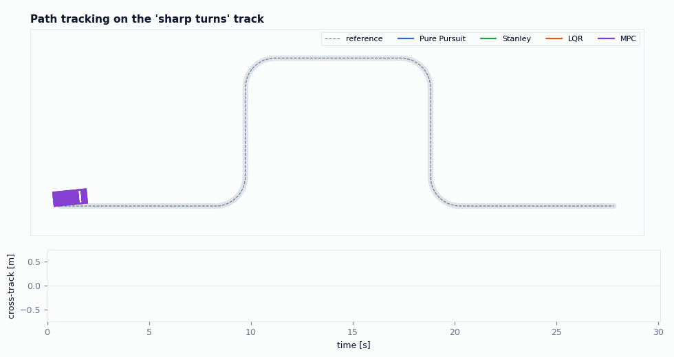

# Linear-quadratic regulator (LQR)

Header: [`include/roboticscore/control/lqr.hpp`](../../../include/roboticscore/control/lqr.hpp) · source: [`src/control/lqr.cpp`](../../../src/control/lqr.cpp)

## Purpose

Discrete-time LQR building blocks and a path tracker:

- `solve_dare`: infinite-horizon gain from the discrete algebraic Riccati equation (DARE),
  solved with the structure-preserving doubling algorithm (SDA).
- `finite_horizon_lqr`: time-varying gains from the backward Riccati recursion.
- `LqrTracker`: steering control on the linearised kinematic error dynamics, gain-scheduled on
  speed, including reverse driving.

## Mathematical formulation

For $x_{k+1} = A x_k + B u_k$ and cost $\sum_k x_k^\top Q x_k + u_k^\top R u_k$, the optimal
feedback is $u = -Kx$ with

$$
P = A^\top P A - A^\top P B (R + B^\top P B)^{-1} B^\top P A + Q, \qquad K = (R + B^\top P B)^{-1} B^\top P A .
$$

**SDA recursion** (as in `lqr.hpp`), with $A_0 = A$, $G_0 = B R^{-1} B^\top$, $H_0 = Q$:

$$
\begin{aligned}
W_k &= I + G_k H_k \\
A_{k+1} &= A_k W_k^{-1} A_k \\
G_{k+1} &= G_k + A_k W_k^{-1} G_k A_k^\top \\
H_{k+1} &= H_k + A_k^\top H_k W_k^{-1} A_k
\end{aligned}
$$

and $H_k \to P$ quadratically. A stabilising solution exists if $(A, B)$ is stabilisable and
$(A, Q^{1/2})$ is detectable.

**Finite horizon** (time-invariant system, terminal weight $Q_f$): $P_N = Q_f$ and for
$k = N-1, \dots, 0$

$$
K_k = (R + B^\top P_{k+1} B)^{-1} B^\top P_{k+1} A, \qquad P_k = Q + A^\top P_{k+1} (A - B K_k).
$$

**Path tracker.** With lateral error $e_y$ (rear axle, positive left), heading error
$e_\psi = \psi - \psi_{\mathrm{path}}$, curvature feedforward $\delta_{ff} = \arctan(L\kappa)$ and
control period $\Delta t$:

$$
e_{y,k+1} = e_{y,k} + v\,\Delta t\, e_{\psi,k}, \qquad
e_{\psi,k+1} = e_{\psi,k} + \frac{v\,\Delta t}{L \cos^2\delta_{ff}} (\delta_k - \delta_{ff}),
$$

$Q = \mathrm{diag}(q_{\mathrm{lat}}, q_{\mathrm{head}})$, $R = r_{\mathrm{steer}}$, and
$\delta = \mathrm{clamp}(\delta_{ff} - K [e_y,\ e_\psi]^\top)$.

## Assumptions

- `solve_dare`: $Q$ symmetric positive semidefinite, $R$ symmetric positive definite,
  stabilisability/detectability as above, $I + G_k H_k$ invertible along the iteration.
- `LqrTracker`: kinematic bicycle without slip, small heading error (linearisation), path
  curvature varying slowly compared with the closed-loop dynamics.

## Algorithm

`solve_dare(A, B, Q, R, max_iterations = 100, tolerance = 1e-12)`:

1. Validate dimensions, symmetry and definiteness (throws `std::invalid_argument`).
2. Iterate the SDA, solving with $W_k$ by partial-pivoting LU and symmetrising $G_k, H_k$.
   Stop when $\lVert H_{k+1} - H_k\rVert_F / \max(1, \lVert H_{k+1}\rVert_F) <$ `tolerance` or
   when $H_k$ becomes non-finite.
3. Compute $K$, the relative residual
   $\lVert A^\top P A - A^\top P B K + Q - P\rVert_F / \max(1, \lVert P\rVert_F)$ and the
   spectral radius of $A - BK$.
4. Report `converged = residual < 1e-8 && spectral_radius < 1`.

`tolerance` only stops the loop; `converged` is decided by the residual and closed-loop
stability check.

`LqrTracker::compute`: project the rear axle, build $A, B$ for the current speed and the
`dt` passed to `compute`, solve the DARE, apply feedforward plus feedback, run the PID speed loop.

## Implementation notes

- Gain scheduling: the speed used in $A, B$ is
  $v_g = \sigma \max(\lvert v\rvert, v_{\min})$ with $v_{\min}$ = `min_gain_speed`.
  $\sigma = \mathrm{sign}(v)$ when $\lvert v\rvert > 10^{-3}$, otherwise the sign of the
  reference speed. Because $v$ enters with its sign, the same law tracks reverse segments.
- The DARE is solved from scratch each step (no warm start); `last_gain()` returns the
  $1\times 2$ gain. `DareResult::converged` is not checked by the tracker before $K$ is used.
- `finite_horizon_lqr` returns $K_0, \dots, K_{N-1}$ (index = time step); with $Q_f = 0$ the
  last gain is zero.

## Complexity

SDA: $O(n^3)$ per iteration (dense LU and products); convergence is quadratic, and the
unit test on a 2-D double integrator requires fewer than 30 iterations.
Finite horizon: $O(N (n^3 + m^3))$. Tracker: one $2\times 2$ DARE per control step.

## Configuration

`LqrTrackerConfig`:

| Field | Default | Meaning |
|---|---|---|
| `q_lateral` | `1.0` 1/m² | $q_{\mathrm{lat}}$ (must be $> 0$) |
| `q_heading` | `1.0` 1/rad² | $q_{\mathrm{head}}$ ($\ge 0$) |
| `r_steering` | `2.0` 1/rad² | $r_{\mathrm{steer}}$ (must be $> 0$) |
| `min_gain_speed` | `0.5` m/s | speed floor $v_{\min}$ for the gain computation |
| `curvature_feedforward` | `true` | use $\delta_{ff} = \arctan(L\kappa)$ |
| `speed_pid` | `{1.5, 0.3, 0.0, -3.0, 3.0, 0.0, kClamping, 1.0}` | speed loop, see [PID](pid.md) |

`solve_dare` defaults: `max_iterations = 100`, `tolerance = 1e-12`.

## Example

```cpp
#include "roboticscore/control/lqr.hpp"
#include "roboticscore/models/double_integrator.hpp"

using namespace roboticscore;

const models::DoubleIntegrator di(2, 0.1);               // 2-D, dt = 0.1 s
const MatX q = MatX::Identity(4, 4);
const MatX r = 0.1 * MatX::Identity(2, 2);
const control::DareResult dare = control::solve_dare(di.a(), di.b(), q, r);
if (dare.converged) {
  const VecX x = (VecX(4) << 1.0, -0.5, 0.0, 0.0).finished();
  const VecX u = -dare.k * x;                             // state feedback
}
const auto gains = control::finite_horizon_lqr(di.a(), di.b(), q, r, MatX::Zero(4, 4), 50);

control::LqrTracker tracker(models::BicycleParams{2.7, 0.6, 10.0, 3.0});
// tracker.compute(state, path, dt) as for the other PathTracker classes.
```



Render with `python scripts/render/render_controllers.py`.

## Benchmark

From [`docs/benchmarks/README.md`](../../benchmarks/README.md) (same setup as the other trackers):

| Track | Cross-track RMSE [m] | Max cross-track [m] | Heading RMSE [rad] | Steering-rate energy | Compute [us/step] |
|---|---:|---:|---:|---:|---:|
| circle | 1.7e-04 | 3.6e-04 | 2.1e-05 | 9.1e-05 | 11.2 |
| s curve | 0.005 | 0.009 | 9.6e-04 | 0.341 | 9.8 |
| sharp turns | 0.027 | 0.065 | 0.009 | 14.330 | 9.9 |
| variable curvature | 0.004 | 0.009 | 7.1e-04 | 0.335 | 10.0 |

Microbenchmark `BM_DareDoubleIntegrator`: 17,320.2 ns real time (16,497.0 ns CPU).

## Known limitations

- The tracker uses the kinematic model only: no tyre slip, no actuator lag, no steering-rate
  limit. On the sharp-turns track its steering-rate energy (14.330) is several times that of
  the other controllers.
- Constraints are handled only by clamping the final steering command.
- The infinite-horizon gain for the current speed is used; the path ahead enters only through
  the feedforward at the current projection (no preview).
- `finite_horizon_lqr` supports time-invariant $A, B, Q, R$ only.
- Dense $O(n^3)$ linear algebra; intended for small systems.

## References

- B. D. O. Anderson and J. B. Moore, *Optimal Control: Linear Quadratic Methods*, Prentice Hall, 1990.
- Chu, Fan, Lin and Weng, structure-preserving doubling algorithm (SDA) for discrete-time
  algebraic Riccati equations, *Linear Algebra and its Applications*, 2004.
- J. M. Snider, *Automatic Steering Methods for Autonomous Automobile Path Tracking*, Technical
  Report CMU-RI-TR-09-08, Robotics Institute, Carnegie Mellon University, 2009.
