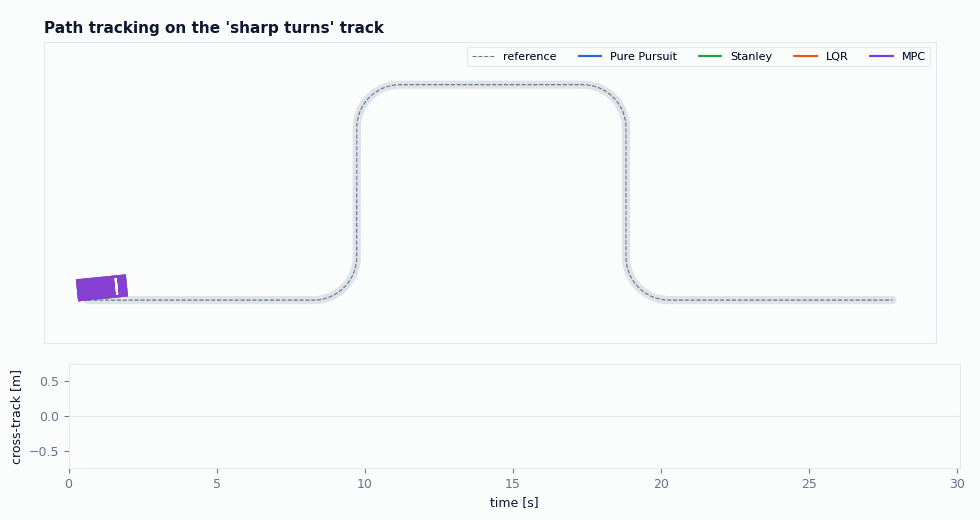
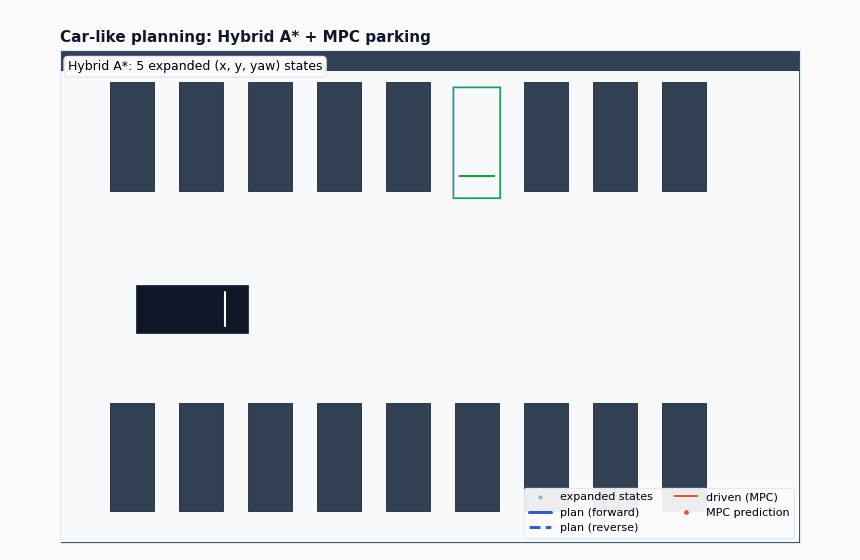

# Linear time-varying MPC path tracking

Headers: [`include/roboticscore/control/mpc.hpp`](../../../include/roboticscore/control/mpc.hpp), [`include/roboticscore/optimization/qp_solver.hpp`](../../../include/roboticscore/optimization/qp_solver.hpp) · source: [`src/control/mpc.cpp`](../../../src/control/mpc.cpp)

## Purpose

`MpcTracker` controls acceleration and steering of a car-like vehicle jointly by solving, at
every control step, a quadratic program over a receding horizon. It enforces input,
steering-rate and speed limits explicitly (the geometric trackers and LQR only clamp the final
steering command) and handles reverse segments with the same model. It is the tracker used in
the parking pipeline.

## Mathematical formulation

State $x = (x, y, \psi, v)$ at the rear axle, input $u = (a, \delta)$, prediction step $h$
(`MpcConfig::dt`), horizon $N$.

**Reference.** Starting at the arc length $s_0$ of the rear-axle projection,
$s_{k+1} = s_k + \max(\lvert v_{\mathrm{ref}}(s_k)\rvert, 0.5)\,h$ and
$r_k = (p(s_k),\ \psi_{\mathrm{ref}}(s_k),\ v_{\mathrm{ref}}(s_k))$ for $k = 0..N$, with reference yaw
unwrapped around the current yaw. Feedforward inputs:
$u_{\mathrm{ref},k} = \big((v_{\mathrm{ref},k+1} - v_{\mathrm{ref},k})/h,\ \arctan(L\kappa(s_k))\big)$.

**Model.** The kinematic bicycle is linearised about $(r_k, u_{\mathrm{ref},k})$ and discretised
with forward Euler (`KinematicBicycle::linearize`):

$$
x_{k+1} = A_k x_k + B_k u_k + c_k, \qquad A_k = I + h\,\partial_x f, \quad B_k = h\,\partial_u f, \quad c_k = h\,(f - \partial_x f\, r_k - \partial_u f\, u_{\mathrm{ref},k}).
$$

**Condensed QP.** Stacking $X = (x_1, \dots, x_N)$ and $U = (u_0, \dots, u_{N-1})$ gives
$X = \Phi x_0 + \Gamma U + \Psi$. The cost is

$$
J = \sum_{k=1}^{N} w_k \lVert x_k - r_k\rVert^2_Q + \sum_{k=0}^{N-1} \lVert u_k - u_{\mathrm{ref},k}\rVert^2_R + \lVert u_k - u_{k-1}\rVert^2_{R_d},
$$

with $w_N$ = `terminal_weight_scale`, $w_k = 1$ otherwise, and $u_{-1}$ the input applied at the
previous step. With the difference operator $D$ ($DU - d_0 = (u_0 - u_{-1}, u_1 - u_0, \dots)$)
this is the QP $\min \tfrac12 U^\top P U + q^\top U$ with

$$
P = 2\,(\Gamma^\top \bar Q \Gamma + \bar R + D^\top \bar R_d D), \qquad
q = 2\,\big(\Gamma^\top \bar Q (\Phi x_0 + \Psi - X_{\mathrm{ref}}) - \bar R U_{\mathrm{ref}} - D^\top \bar R_d d_0\big),
$$

subject to $4N$ constraint rows: $\lvert a_k\rvert \le a_{\max}$, $\lvert\delta_k\rvert \le \delta_{\max}$ (2N rows),
$\lvert\delta_k - \delta_{k-1}\rvert \le \dot\delta_{\max}\,\Delta_k$ (N rows) and
$v_{\min} \le v_{k+1} \le v_{\max}$ (N rows, through $\Gamma$). Here $\Delta_0$ is the control
period `dt` passed to `compute` and $\Delta_k = h$ for $k \ge 1$.

## Assumptions

- Kinematic bicycle without tyre slip; inputs held constant over each prediction step.
- The vehicle stays close to the reference, so the linearisation about the reference (not
  about the predicted trajectory) is accurate.
- The reference path carries signed speeds and the vehicle yaw as heading
  (see [trajectories](../trajectory/trajectories.md)).

## Algorithm

1. Project the rear axle and sample $r_0..r_N$ and $u_{\mathrm{ref}}$.
2. Linearise and build $\Gamma$ and the free response $\Phi x_0 + \Psi$ recursively.
3. Assemble $P, q$ and the constraint matrix; a defensive check swaps any inverted bound
   pair so that $l \le u$ always holds for the solver.
4. Solve with `optimization::solve_qp`, warm-started with the previous solution shifted by one
   step and the previous multipliers.
5. Apply the clamped first input $u_0$; store it as $u_{-1}$ for the next step and store the
   predicted positions in `status().prediction`.

## Implementation notes

- The QP solver is the library's dense ADMM implementation of the OSQP iteration
  (Ruiz scaling, adaptive $\rho$), not the OSQP library; see
  [least squares and QP](../optimization/least_squares_and_qp.md).
- The first input is applied even when the QP stopped at its iteration limit; check
  `last_qp_solved()` and `last_qp_iterations()`.
- There is no PID speed loop: acceleration comes from the QP.
- The first steering-rate row uses the control period, so the applied steering respects
  the rate limit even when the controller runs faster than its prediction step.
- `reset()` clears the warm start, the previous input and the projection hint.

## Complexity

Decision variables $n = 2N$, constraints $m = 4N$. Building $\Gamma$ and $P$ costs
$O(N^3)$; the KKT factorisation is dense $O(n^3)$ and is repeated only when adaptive $\rho$
changes by more than a factor 5; each ADMM iteration costs $O(n^2 + mn)$. With the default
$N = 15$: 30 variables and 60 constraints.

## Configuration

`MpcConfig`:

| Field | Default | Meaning |
|---|---|---|
| `horizon` | `15` | $N$ (at least 2) |
| `dt` | `0.1` s | prediction step $h$ |
| `state_weights` | `(2.0, 2.0, 3.0, 0.5)` | $Q$ for $(x, y, \psi, v)$ |
| `input_weights` | `(0.05, 0.2)` | $R$ for $(a, \delta)$ deviation from feedforward (must be $> 0$) |
| `input_rate_weights` | `(0.1, 3.0)` | $R_d$ for the change of $(a, \delta)$ per step |
| `terminal_weight_scale` | `3.0` | $w_N$ |
| `max_steer_rate` | `0.8` rad/s | $\dot\delta_{\max}$ |
| `min_speed` | `-3.0` m/s | $v_{\min}$ ($v_{\max}$ is `BicycleParams::max_speed`) |
| `qp` | `{0.1, 1e-6, 1.6, 1e-4, 1e-4, 400, 1e3}` | `QpSettings`: rho, sigma, alpha, eps_abs, eps_rel, max_iterations, equality_rho_scale; the rest at their defaults |

## Example

```cpp
#include "roboticscore/control/mpc.hpp"
#include "roboticscore/trajectory/tracks.hpp"

using namespace roboticscore;

auto path = trajectory::make_track(trajectory::TrackType::kSharpTurns, 5.0);
path.apply_speed_profile(6.0, 1.5, 2.0);
const models::BicycleParams car{2.7, 0.6, 10.0, 3.0};
const models::KinematicBicycle model(car);
control::MpcConfig cfg;
cfg.horizon = 20;
control::MpcTracker mpc(car, cfg);

models::BicycleState x(0.0, 1.0, 0.1, 0.0);
for (int k = 0; k < 3000 && !mpc.status().finished; ++k) {
  const control::VehicleCommand u = mpc.compute(x, path, 0.05);
  if (!mpc.last_qp_solved()) { /* hit cfg.qp.max_iterations; u is the last iterate */ }
  x = model.step(x, models::BicycleInput(u.acceleration, u.steering), 0.05);
}
```




Path tracking comparison and a Hybrid A* parking plan tracked by MPC. Render with
`python scripts/render/render_controllers.py` and `python scripts/render/render_parking.py`.

## Benchmark

From [`docs/benchmarks/README.md`](../../benchmarks/README.md); compute time is the whole
controller step (reference sampling, condensing and QP), not the QP alone:

| Track | Cross-track RMSE [m] | Max cross-track [m] | Heading RMSE [rad] | Steering-rate energy | Compute [us/step] |
|---|---:|---:|---:|---:|---:|
| straight | 0.000 | 0.000 | 0.000 | 0.000 | 143.1 |
| circle | 0.052 | 0.058 | 0.003 | 4.9e-04 | 128.8 |
| s curve | 0.051 | 0.071 | 0.008 | 0.320 | 192.4 |
| sharp turns | 0.051 | 0.101 | 0.022 | 2.894 | 179.6 |
| variable curvature | 0.053 | 0.079 | 0.007 | 0.318 | 164.6 |

## Known limitations

- Linearisation is about the reference, once per step (no re-linearisation about the
  predicted trajectory); large deviations from the path degrade the prediction.
- The prediction model is a forward-Euler discretisation at $h$ and has no tyre slip or
  actuator dynamics.
- The QP is solved by a first-order method to `eps` $10^{-4}$ within 400 iterations;
  constraints hold only up to that tolerance (the unit test allows 5 % on the steering rate).
- The QP solver has no infeasibility detection: conflicting constraints (e.g. a speed far
  outside the bounds with limited acceleration) end at the iteration limit and the last
  iterate is applied.
- No terminal constraint or terminal cost from a Riccati solution, hence no formal
  stability guarantee; the dense condensed form scales cubically with the horizon.
- No obstacle constraints; collision avoidance must come from the planner.

## References

- J. B. Rawlings, D. Q. Mayne and M. M. Diehl, *Model Predictive Control: Theory, Computation,
  and Design*, 2nd ed., Nob Hill Publishing, 2017.
- B. Stellato, G. Banjac, P. Goulart, A. Bemporad and S. Boyd, "OSQP: an operator splitting
  solver for quadratic programs", *Mathematical Programming Computation*, 2020.
- J. M. Snider, *Automatic Steering Methods for Autonomous Automobile Path Tracking*, Technical
  Report CMU-RI-TR-09-08, Robotics Institute, Carnegie Mellon University, 2009.
