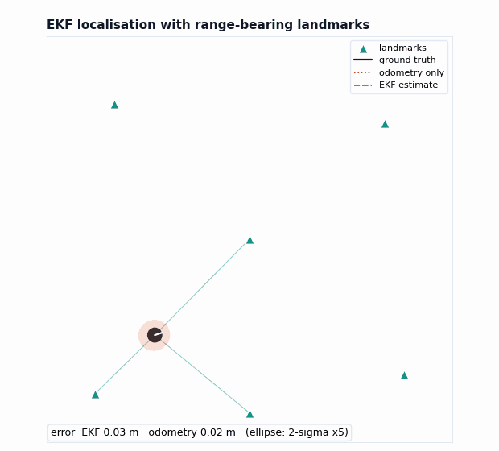

# Extended Kalman filter

Header: [`include/roboticscore/estimation/extended_kalman_filter.hpp`](../../../include/roboticscore/estimation/extended_kalman_filter.hpp), [`localization/robot_models.hpp`](../../../include/roboticscore/localization/robot_models.hpp)

## Purpose

`estimation::ExtendedKalmanFilter` estimates the state of a nonlinear system by
linearising the process and measurement models around the current estimate. You plug models
in as callables (`ProcessModel`, `MeasurementModel`). `localization/robot_models.hpp`
supplies planar-localisation models: a unicycle process model, range-bearing and position
measurement models, and a pose state space with heading wrapping.

## Mathematical formulation

Prediction, with $F = \partial f / \partial x$ evaluated at $(\hat{x}, u, \Delta t)$:

$$\hat{x}^- = \mathrm{normalize}\big(f(\hat{x}, u, \Delta t)\big), \qquad P^- = F P F^\top + Q(\hat{x}, u, \Delta t)$$

Update, with $H = \partial h / \partial x$ evaluated at $\hat{x}^-$:

$$y = \mathrm{residual}(z, h(\hat{x}^-)), \quad S = H P^- H^\top + R, \quad K = P^- H^\top S^{-1}, \quad \hat{x} = \mathrm{normalize}(\hat{x}^- + K y)$$

The covariance update is the Joseph form
$P = (I-KH)P^-(I-KH)^\top + KRK^\top$. A measurement is rejected if
$\mathrm{NIS} = y^\top S^{-1} y$ exceeds the gate.

**Unicycle model.** The state is $(x, y, \theta)$ and the control is $(v, \omega)$. The
motion is an exact circular arc:

$$x' = x + v\Delta t\,\mathrm{sinc}(\tfrac{\omega\Delta t}{2})\cos(\theta + \tfrac{\omega\Delta t}{2}), \quad y' = y + v\Delta t\,\mathrm{sinc}(\tfrac{\omega\Delta t}{2})\sin(\theta + \tfrac{\omega\Delta t}{2}), \quad \theta' = \theta + \omega\Delta t$$

Process noise is control noise mapped into state space: $Q = V M V^\top$ with
$V = \partial f / \partial u$ and

$$M = \mathrm{diag}\big(\alpha_1 v^2 + \alpha_2 \omega^2 + \sigma^2_{v,\min},\; \alpha_3 v^2 + \alpha_4 \omega^2 + \sigma^2_{\omega,\min}\big)$$

**Range-bearing model.** For a landmark $m$, with $\delta = m - (x, y)$ and
$q = \delta^\top\delta$, the prediction is
$h = (\sqrt{q},\ \mathrm{wrap}(\operatorname{atan2}(\delta_y, \delta_x) - \theta))$. Headings
and bearings are wrapped to $[-\pi, \pi)$.

## Assumptions

- $f$ and $h$ are differentiable and close to linear within the region of the estimation
  error.
- Noise is additive, zero-mean and Gaussian. $Q$ is evaluated at the prior mean.
- Known data association: each measurement model refers to a known landmark.
- For the range-bearing model, the robot is not at the landmark. The Jacobian throws
  `NumericalError` for ranges below 1e-9 m.

## Algorithm

1. `predict(model, u, dt)`:
   1. Evaluate $F$ (analytic, or central differences if `model.jacobian` is empty) and $Q$.
   2. Propagate the mean through $f$ and normalise it.
   3. Compute $P = F P F^\top + Q$ and symmetrise.
2. `update(model, z, gate)`:
   1. Compute $\hat{z} = h(\hat{x})$ and $H$ (analytic or numerical).
   2. Compute the innovation with `model.residual`, or $z - \hat{z}$ if it is empty.
   3. Call `kalman_update()`, which performs the gating, gain and Joseph update.
   4. If the measurement was accepted, normalise the state.

## Implementation notes

- **State geometry.** `StateSpace` (`residual`, `normalize`, `mean`) describes the geometry
  of the state, so the generic filter never knows which component is a heading.
  `localization::pose_state_space()` wraps index 2. Pass it to the constructor.
- **Numerical Jacobians.** When `jacobian` is empty, central-difference Jacobians are used.
  The finite-difference outputs are compared with the state-space residual (or the
  measurement residual), so a bearing near $\pm\pi$ does not produce a spurious $2\pi$
  derivative.
- **Covariance floor.** The unicycle noise adds $10^{-12} I$ to $Q$. The `VelocityNoise`
  floors `min_var_v` and `min_var_omega` keep $M$ positive definite when the robot is
  stationary.
- **Verified by tests** (`test_kalman_filters.cpp`): the EKF reproduces the linear KF
  through the numerical-Jacobian path; bearing innovations across $\pm\pi$ are wrapped;
  analytic and numerical Jacobians agree; landmark localisation converges with NEES below 20.

## Complexity

The theoretical cost is $O(n^3 + m^3)$ per predict/update. Numerical Jacobians add $2n$
model evaluations. For the 3-state pose filter all matrices are tiny; see the measured
runtime below.

## Configuration

There is no configuration struct. The constructor takes
`ExtendedKalmanFilter(VecX x0, const MatX& p0, StateSpace space = {})`.

| Item | Meaning |
|---|---|
| `ProcessModel::f` | Required transition $f(x, u, \Delta t)$ |
| `ProcessModel::noise` | Required process covariance $Q(x, u, \Delta t)$ |
| `ProcessModel::jacobian` | Optional $\partial f/\partial x$; numerical if empty |
| `MeasurementModel::h` | Required measurement function |
| `MeasurementModel::noise` | Measurement covariance $R$ |
| `MeasurementModel::jacobian` | Optional $\partial h/\partial x$; numerical if empty |
| `MeasurementModel::residual` | Optional wrapped difference; Euclidean if empty |
| `gate` | NIS threshold, default `kNoGate` |
| `VelocityNoise` | `alpha1 = 0.01`, `alpha2 = 0.001`, `alpha3 = 0.001`, `alpha4 = 0.01`, `min_var_v = 1e-6`, `min_var_omega = 1e-6` |

## Example

```cpp
#include "roboticscore/estimation/extended_kalman_filter.hpp"
#include "roboticscore/localization/robot_models.hpp"
#include "roboticscore/math/statistics.hpp"

using namespace roboticscore;
namespace est = roboticscore::estimation;
namespace loc = roboticscore::localization;

const auto process = loc::unicycle_process_model(loc::VelocityNoise{});
const auto meas = loc::range_bearing_model(Vec2(5.0, 5.0), 0.1, 0.02);
est::ExtendedKalmanFilter ekf(Vec3(0, 0, 0), Mat3::Identity() * 0.1,
                              loc::pose_state_space());

ekf.predict(process, Vec2(1.0, 0.1), 0.1);              // u = (v, omega), dt = 0.1 s
const double gate = math::chi_squared_quantile(0.99, 2.0);
const est::UpdateResult r = ekf.update(meas, Vec2(7.0, 0.7), gate);
// r.accepted, r.stats.nis, ekf.state(), ekf.covariance()
```



The animation shows EKF landmark localisation against dead reckoning. Reproduce it with
`python scripts/render/render_ekf_localization.py`.

## Benchmark

Source: [docs/benchmarks/README.md](../../benchmarks/README.md). The scenario is a unicycle
robot with range-bearing landmarks, 300 steps at 10 Hz, medians over 20 seeds.

| Scenario | Filter | Position RMSE [m] | Mean NEES | Mean NIS | Time [ms/step] |
|---|---|---:|---:|---:|---:|
| low noise | EKF | 0.015 | 3.05 | 1.99 | 0.0079 |
| high odometry noise | EKF | 0.023 | 3.38 | 2.05 | 0.0080 |
| outlier measurement | EKF | 0.371 | 2,739.77 | 1,881.78 | 0.0105 |
| outlier measurement | EKF + 99% gate | 0.017 | 3.32 | 1.91 | 0.0075 |

`BM_EkfPredictUpdate` (one predict and one range-bearing update of the pose filter) has a
median real time of 1,778.6 ns. Under 5% outliers the ungated EKF is badly inconsistent; the
99% chi-square gate restores consistency.

## Known limitations

- **Linearisation error.** The EKF is consistent only while the error stays in the region
  where $f$ and $h$ are nearly linear. With large heading uncertainty, the Jacobians are
  evaluated at the wrong point and the covariance becomes overconfident (NEES grows). This
  can lead to divergence.
- **Mean bias.** The EKF ignores curvature in the mean. For example, in a polar-to-Cartesian
  transform the EKF mean stays at the linearisation point. The UKF test
  `BeatsEkfOnPolarToCartesianBias` documents this.
- **Unimodal.** The filter cannot represent multimodal beliefs such as global localisation
  or the kidnapped-robot problem. Use the particle filter for those.
- **Outliers.** Without a gate a single outlier corrupts the estimate (see the outlier
  scenario above). With a gate, true measurements may be rejected after a long period
  without updates.

## References

- S. Thrun, W. Burgard, D. Fox, *Probabilistic Robotics*, MIT Press, 2005.
- Y. Bar-Shalom, X. R. Li, T. Kirubarajan, *Estimation with Applications to Tracking and
  Navigation*, Wiley, 2001.
- R. E. Kalman, "A New Approach to Linear Filtering and Prediction Problems", Transactions
  of the ASME, Journal of Basic Engineering, 1960.
