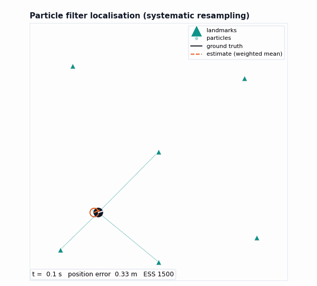

# Particle filter (SIR)

Header: [`include/roboticscore/estimation/particle_filter.hpp`](../../../include/roboticscore/estimation/particle_filter.hpp), [`resampling.hpp`](../../../include/roboticscore/estimation/resampling.hpp)

## Purpose

`estimation::ParticleFilter` is a generic sequential importance resampling (SIR) filter. It
represents arbitrary, including multimodal, beliefs with weighted samples. Typical uses are
localisation from a poor prior and problems with non-Gaussian likelihoods.
`resampling.hpp` provides four unbiased resampling schemes and the effective sample size.

## Mathematical formulation

The belief is $\lbrace x^{(i)}, w^{(i)} \rbrace_{i=1}^N$. The bootstrap filter uses the motion model as
the proposal:

$$x_k^{(i)} \sim p(x_k \mid x_{k-1}^{(i)}, u_k), \qquad \log w_k^{(i)} = \log w_{k-1}^{(i)} + \log p(z_k \mid x_k^{(i)}) - \log Z_k$$

The normaliser is computed with log-sum-exp:

$$\log Z_k = m + \log \sum_i \exp\big(\ell^{(i)} - m\big), \qquad m = \max_i \ell^{(i)}, \qquad \ell^{(i)} = \log w_{k-1}^{(i)} + \log p(z_k \mid x_k^{(i)})$$

Because the previous weights are normalised, $\log Z_k$ is the log of the weighted mean
likelihood, an estimate of $\log p(z_k \mid z_{1:k-1})$.

The effective sample size is $\mathrm{ESS} = 1 / \sum_i (w^{(i)})^2 \in [1, N]$. Resampling
draws $N$ ancestors so that the expected number of copies of particle $i$ is $N w^{(i)}$:

| Scheme | Draw | Cost here |
|---|---|---|
| multinomial | $N$ independent uniforms, sorted | $O(N \log N)$ |
| stratified | one uniform per stratum $[j/N, (j+1)/N)$ | $O(N)$ |
| systematic | shared offset $u_0 + j/N$; copies are $\lfloor N w_i \rfloor$ or $\lceil N w_i \rceil$ | $O(N)$ |
| residual | $\lfloor N w_i \rfloor$ deterministic copies, remainder multinomial | $O(N \log N)$ |

The mean uses `StateSpace::mean` (circular for headings). The covariance is
$\sum_i w^{(i)} d_i d_i^\top$ with $d_i = \mathrm{residual}(x^{(i)}, \bar{x})$.

## Assumptions

- You can sample from the motion model and evaluate $\log p(z \mid x)$ pointwise.
- $N$ is large enough to cover the posterior. With the motion-model proposal, this matters
  most when the likelihood is much narrower than the prediction.
- Particles are i.i.d. given the previous step. The filter injects no random particles.

## Algorithm

1. Construct from particles or with `from_gaussian(mean, cov, N, rng, space)`; weights
   start uniform.
2. `predict(motion, rng)`: move every column in place with `motion`, then normalise it.
3. `update(log_likelihood)`: add the log-likelihood to each log weight (NaN becomes
   $-\infty$) and normalise with log-sum-exp. If every weight is zero, mark the update
   `degenerate` and keep the previous weights.
4. `resample_if_needed(threshold, method, rng)`: if
   $\mathrm{ESS} < \text{threshold} \cdot N$, resample and reset the weights to $1/N$.
5. Read the estimate with `mean()` and `covariance()`.

## Implementation notes

- **Log-domain weights.** Weights are stored as normalised log weights
  (`logsumexp == 0`), so extremely peaked likelihoods do not underflow. A unit test uses
  log-likelihoods whose exponentials underflow in linear space.
- **Degenerate updates.** A degenerate update is reported, not fixed: `degenerate = true`,
  `log_evidence = -inf`, and the weights are unchanged. Recovery is left to the caller, for
  example by injecting random particles.
- **Storage and generic models.** Particles are columns of one dense `MatX`. The motion
  model receives an `Eigen::Ref` column and an explicit `math::Random&`, so runs are
  reproducible across compilers.
- **Resampling.** All schemes map sorted positions onto the CDF in one linear sweep. The
  last CDF entry is forced to 1 to guard against round-off. Residual resampling pads with
  the heaviest particle if round-off leaves the count short. Ancestor indices are returned
  in non-decreasing order.
- **Verified by tests** (`test_ukf_particle.cpp`, `tests/numerical`):
  - resampling: systematic copies are floor or ceil of $N w_i$, all schemes are unbiased
    and skip zero weights, invalid weights are rejected;
  - weights stay normalised under underflow, and degenerate updates behave as described;
  - mean and variance match the Kalman posterior within 0.03 on a linear Gaussian model
    with 20,000 particles;
  - landmark localisation converges from a poor prior, and zero noise collapses gracefully.

## Complexity

The header states $O(N d)$ per step for prediction and weighting, plus $O(N)$ for
resampling. Here $d$ is the state dimension; each model call has its own cost. In this
implementation multinomial and residual resampling sort their uniforms, which costs
$O(N \log N)$. `covariance()` costs $O(N d^2)$.

## Configuration

There is no configuration struct. The parameters are:

| Parameter | Meaning |
|---|---|
| `particles` / `count` | Initial particle set (columns) or number of particles drawn from a Gaussian |
| `space` | `StateSpace` (`residual`, `normalize`, `mean`); default Euclidean |
| `MotionModel` | `void(Eigen::Ref<VecX> particle, math::Random& rng)` |
| `LogLikelihood` | `double(const Eigen::Ref<const VecX>& particle)` |
| `threshold_ratio` | ESS fraction in $[0, 1]$ that triggers resampling (0.5 is common) |
| `ResamplingMethod` | `kMultinomial`, `kStratified`, `kSystematic`, `kResidual` |

## Example

```cpp
#include "roboticscore/estimation/particle_filter.hpp"
#include "roboticscore/localization/robot_models.hpp"
#include "roboticscore/models/unicycle.hpp"

using namespace roboticscore;
namespace est = roboticscore::estimation;
namespace loc = roboticscore::localization;

math::Random rng(21);
auto pf = est::ParticleFilter::from_gaussian(Vec3(0, 0, 0), Vec3(4.0, 4.0, 0.5).asDiagonal(),
                                             2000, rng, loc::pose_state_space());
const Vec2 landmark(8.0, 0.0);
const Vec2 z(7.1, -0.4);  // measured (range, bearing)

pf.predict([&](Eigen::Ref<VecX> x, math::Random& g) {
  x = models::Unicycle::step(Vec3(x), {0.8 + g.normal(0, 0.05), 0.15 + g.normal(0, 0.02)}, 0.1);
}, rng);
const est::ParticleUpdateResult res = pf.update([&](const Eigen::Ref<const VecX>& x) {
  return loc::range_bearing_log_likelihood(Vec3(x), landmark, z, 0.2, 0.05);
});
if (!res.degenerate) {
  pf.resample_if_needed(0.5, est::ResamplingMethod::kSystematic, rng);
}
const VecX estimate = pf.mean();
```



The animation shows particle filter localisation from a poor prior. Reproduce it with
`python scripts/render/render_particle_filter.py`.

## Benchmark

Source: [docs/benchmarks/README.md](../../benchmarks/README.md). The table shows PF (500
particles) in the state-estimation scenarios, medians over 20 seeds.

| Scenario | Position RMSE [m] | Heading RMSE [rad] | Time [ms/step] |
|---|---:|---:|---:|
| low noise | 0.015 | 0.0036 | 0.2143 |
| high odometry noise | 0.025 | 0.0049 | 0.2175 |
| sparse landmarks | 0.049 | 0.0080 | 0.1684 |
| outlier measurement | 0.053 | 0.0121 | 0.2232 |

The particle filter is robust to outliers without gating, but costs about 20x more per step
than the EKF with 500 particles (README). NEES/NIS are not reported for the PF.

## Known limitations

- **Weight degeneracy.** With a narrow likelihood or an uninformative proposal, a few
  particles carry all the weight and the ESS collapses. Monitor
  `ParticleUpdateResult::effective_sample_size`.
- **Sample impoverishment.** Resampling duplicates particles. With low process noise the
  set collapses onto a few distinct states, and there is no roughening or regularisation.
- **Particle deprivation.** If no particle is near the truth, for example after a
  kidnapping, the filter cannot recover unless the caller injects particles. A fully
  degenerate update only reports `degenerate`.
- **Dimensionality.** The number of particles needed grows quickly with state dimension.
  The filter is practical for low-dimensional states such as planar poses.

## References

- N. J. Gordon, D. J. Salmond, A. F. M. Smith, "Novel Approach to Nonlinear/Non-Gaussian
  Bayesian State Estimation", IEE Proceedings F, 1993.
- R. Douc, O. Cappé, E. Moulines, "Comparison of Resampling Schemes for Particle
  Filtering", Proc. International Symposium on Image and Signal Processing and Analysis
  (ISPA), 2005.
- A. Kong, J. S. Liu, W. H. Wong, "Sequential Imputations and Bayesian Missing Data
  Problems", Journal of the American Statistical Association, 1994.
- S. Thrun, W. Burgard, D. Fox, *Probabilistic Robotics*, MIT Press, 2005.
