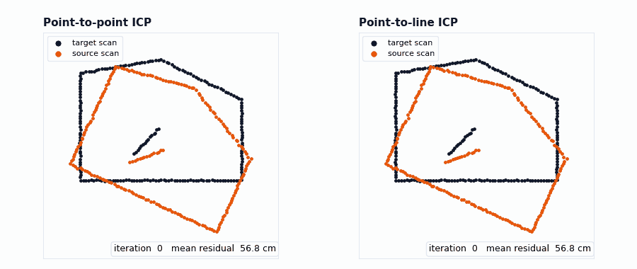

# Iterative Closest Point (2D)

Header: [`include/roboticscore/registration/icp.hpp`](../../../include/roboticscore/registration/icp.hpp)

## Purpose

`registration::icp_2d()` estimates the rigid transform $T \in SE(2)$ that aligns a source
point cloud to a target cloud, typically for LiDAR scan matching. Two error metrics are
available: point-to-point (Besl & McKay) and point-to-line (Chen & Medioni, in its 2D
form). The module also exposes the closed-form fit `best_fit_transform()` and PCA normal estimation
`estimate_normals()`.

## Mathematical formulation

Given pairs $(p_i, q_i)$ of transformed source points and nearest target points, each
iteration solves for an increment $\Delta T$ and composes it as
$T \leftarrow \Delta T \cdot T$.

**Point-to-point.** Minimise $\sum_i \lVert R p_i + t - q_i \rVert^2$. With centroids
$\bar{p}, \bar{q}$ and centred points $p'_i, q'_i$, the closed-form solution is

$$\theta = \operatorname{atan2}\Big(\sum_i p'_i \times q'_i,\; \sum_i p'_i \cdot q'_i\Big), \qquad t = \bar{q} - R(\theta)\,\bar{p}$$

Here $\times$ is the 2D scalar cross product. Reflections cannot occur with this
parameterisation.

**Point-to-line.** Minimise $\sum_i \big(n_i^\top (R p_i + t - q_i)\big)^2$, where $n_i$ is
the unit normal of the target at $q_i$. Linearising at $\Delta\theta = 0$ gives one row per
pair:

$$a_i = \big(n_{i,x},\; n_{i,y},\; n_{i,y} p_{i,x} - n_{i,x} p_{i,y}\big), \qquad r_i = n_i^\top (p_i - q_i), \qquad (A^\top A + \epsilon I)\,\xi = -A^\top r$$

The solution $\xi = (t_x, t_y, \Delta\theta)$ becomes $\Delta T$ with an exact rotation
$R(\Delta\theta)$.

**Normals.** Each target normal is the eigenvector of the smallest eigenvalue of the
neighbourhood covariance over the $k$ nearest neighbours. It is computed in closed form as
the perpendicular to the principal direction $\varphi = \tfrac12 \operatorname{atan2}(2c_{xy}, c_{xx} - c_{yy})$.

## Assumptions

- The initial guess lies inside the basin of attraction of the true alignment.
- The two clouds overlap substantially, and nearest neighbours are mostly true
  correspondences.
- Point-to-line additionally assumes locally linear target structure (walls, edges) with
  enough neighbours to estimate a normal.
- The scene geometry constrains all three degrees of freedom.

## Algorithm

1. Build a k-d tree on the target. For point-to-line, estimate target normals once.
2. For each iteration, up to `max_iterations`:
   1. Transform each source point with $T$ and find its nearest target point.
   2. Keep the pair if its distance is at most `max_correspondence_distance`.
   3. If fewer than `min_correspondences` pairs remain, return `kTooFewCorrespondences`.
   4. Compute $\Delta T$ (closed form or linearised least squares) and set
      $T \leftarrow \Delta T \cdot T$.
   5. Compute the RMSE of the accepted pairs after applying $\Delta T$.
   6. If $|\Delta\theta|$ and $\lVert\Delta t\rVert$ are both below `tolerance`, return
      `kConverged`.
3. Otherwise return `kMaxIterations`.

## Implementation notes

- **Correspondences.** Pairs come from nearest neighbours only. Several source points may
  map to the same target point. There is no reciprocity check or trimming beyond the
  distance threshold.
- **Regularisation.** Point-to-line adds a tiny Tikhonov term,
  $\epsilon = 10^{-9}(\operatorname{tr}(A^\top A) + 1)$. It keeps the $3\times3$ system
  solvable when geometry leaves a direction unconstrained, such as a single straight wall,
  without biasing well-posed problems. Pairs whose target normal is degenerate, $(0, 0)$,
  are skipped.
- **RMSE meaning.** For point-to-line, `rmse` is the RMS of the normal-projected residuals
  $n^\top(\cdot)$, not the Euclidean pair distance. Do not compare it directly with a
  point-to-point RMSE.
- **History.** `record_history` stores the initial guess plus one transform per iteration,
  so `history.size() == iterations + 1`.
- **Degenerate fit.** `best_fit_transform()` with identical points returns an identity
  rotation (the rotation is undefined).
- **Verified by tests** (`tests/unit/mapping/test_icp.cpp`):
  - the closed-form fit is exact; point-to-point converges from a 0.5 degree misalignment;
  - point-to-line converges from 20 degrees in fewer than 30 iterations, and handles a
    noisy partial overlap with spurious points when a 0.5 m correspondence gate is set;
  - wall normals are correct, and `kTooFewCorrespondences` is reported.

## Complexity

The header states $O(n \log m)$ per iteration for $n$ source and $m$ target points, from
k-d tree nearest-neighbour queries. Building the tree costs $O(m \log m)$ once. Normal
estimation costs one $k$-nearest query per target point, also once. The solve per iteration
is $O(n)$, since the system is $3 \times 3$.

## Configuration

`IcpParams`:

| Field | Default | Meaning |
|---|---:|---|
| `method` | `kPointToPoint` | `kPointToPoint` or `kPointToLine` |
| `normal_neighbors` | 5 | Neighbours (including the point) for target normals |
| `max_iterations` | 50 | Iteration limit |
| `tolerance` | 1e-6 | Convergence threshold on incremental rotation and translation |
| `max_correspondence_distance` | 1e9 | Pair rejection distance (partial overlap, outliers) |
| `min_correspondences` | 3 | Fewer accepted pairs abort with `kTooFewCorrespondences` |
| `record_history` | false | Store $T$ after every iteration |

## Example

```cpp
#include <vector>
#include "roboticscore/registration/icp.hpp"

using namespace roboticscore;
namespace reg = roboticscore::registration;

std::vector<Vec2> target;  // reference scan points
std::vector<Vec2> source;  // new scan points (fill both before calling icp_2d)

reg::IcpParams params;
params.method = reg::IcpMethod::kPointToLine;
params.max_correspondence_distance = 0.5;

const geometry::SE2 guess(0.1, 0.0, 0.05);   // e.g. from odometry
const reg::IcpResult r = reg::icp_2d(source, target, params, guess);
if (r.converged()) {
  const geometry::SE2& source_to_target = r.transform;  // maps source into target frame
}
```



The animation compares point-to-point and point-to-line ICP. Reproduce it with
`python scripts/render/render_icp.py`.

## Benchmark

From [docs/benchmarks/README.md](../../benchmarks/README.md), the microbenchmark
`BM_IcpPointToLine` (one complete point-to-line alignment of a synthetic cloud) has a median
real time of 1,072.5 us and a CPU time of 1,001.0 us. No point-to-point figure is reported.
The setup is in `benchmarks/micro_benchmarks.cpp`.

## Known limitations

- **Point-to-point local minima.** From larger misalignments the point-to-point metric
  can settle where sampled wall points sit between their discrete target neighbours. It
  then stalls with a wrong rotation and nonzero RMSE. The unit test
  `Icp.PointToPointLocalMinimumIsDocumentedBehaviour` in `tests/unit/mapping/test_icp.cpp`
  documents this. Started from 20 degrees, point-to-point ICP ends more than 0.5 degrees from
  the truth with RMSE above 0.01, while point-to-line converges from the same start.
- **Local method.** Both variants need a good initial guess; there is no global search.
  Point-to-point also converges slowly along planar structure.
- **Degenerate geometry.** In corridors and other degenerate scenes, the unconstrained
  direction is kept near its initial value by the regulariser rather than estimated.
- **Outliers.** Rejection is only by distance threshold. The default threshold (1e9)
  accepts all pairs, and there are no robust kernels.
- **No uncertainty.** No covariance of the estimated transform is returned.

## References

- P. J. Besl, N. D. McKay, "A Method for Registration of 3-D Shapes", IEEE Transactions on
  Pattern Analysis and Machine Intelligence, 1992.
- Y. Chen, G. Medioni, "Object Modelling by Registration of Multiple Range Images", Image
  and Vision Computing, 1992.
- F. Lu, E. Milios, "Robot Pose Estimation in Unknown Environments by Matching 2D Range
  Scans", Journal of Intelligent and Robotic Systems, 1997.
