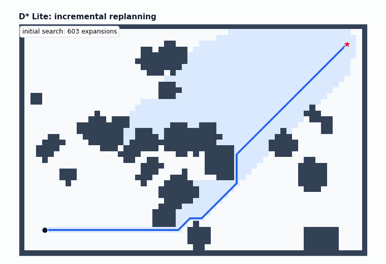

# D* Lite incremental replanning

Header: [`include/roboticscore/planning/grid/dstar_lite.hpp`](../../../include/roboticscore/planning/grid/dstar_lite.hpp) · Source: [`src/planning/grid/dstar_lite.cpp`](../../../src/planning/grid/dstar_lite.cpp)

## Purpose

Shortest paths on a grid whose cells change while the robot moves (obstacles discovered by
sensors, doors closing). D* Lite searches backwards from the goal and, after a change, repairs
only the vertices whose cost-to-goal is affected, instead of running a fresh A* search from
the new robot cell.

## Mathematical formulation

Each vertex keeps a cost-to-goal estimate $g(s)$ and a one-step lookahead

$$
\mathrm{rhs}(s)=\begin{cases}0 & s = s_\text{goal}\\ \min_{s'\in\mathrm{Succ}(s)}\big(c(s,s')+g(s')\big) & \text{otherwise.}\end{cases}
$$

A vertex is consistent if $g(s)=\mathrm{rhs}(s)$; inconsistent vertices are kept in a
priority queue ordered lexicographically by

$$
k(s)=\big[\min(g(s),\mathrm{rhs}(s)) + h(s_\text{start}, s) + k_m;\ \min(g(s),\mathrm{rhs}(s))\big].
$$

$k_m$ is the key modifier. When edge costs change after the robot has moved from
$s_\text{last}$ to $s_\text{start}$, the update $k_m \leftarrow k_m + h(s_\text{last}, s_\text{start})$
keeps all queued keys valid lower bounds without re-sorting the queue. Edge costs $c$ are
those of `GridMap::step_cost` (1, $\sqrt2$, or $\infty$ for blocked cells and corner
cutting); the graph is undirected, so predecessors and successors coincide. The heuristic is
octile for 8-connectivity and Manhattan for 4-connectivity, both admissible and consistent
for these costs.

## Assumptions

- Known, fixed goal; the start (robot cell) is updated with `move_start`, normally to
  `next_step()` (any in-bounds cell is accepted).
- Cell changes are reported explicitly as `CellChange{cell, blocked}`.
- The map size is fixed at construction. Start and goal must be inside the map (they need
  not be free; a blocked endpoint simply yields `kNoPath`).

## Algorithm

`compute_shortest_path` repeats, while the queue is not empty and the termination test below
holds: take the top vertex $u$; if its stored key is smaller than its current key, re-insert
it with the new key; otherwise remove it and

- if $g(u)>\mathrm{rhs}(u)$ (overconsistent): set $g(u)=\mathrm{rhs}(u)$ and update all neighbours;
- else (underconsistent): set $g(u)=\infty$ and update $u$ and all neighbours.

`update_vertex(u)` recomputes $\mathrm{rhs}(u)$ and (re)queues $u$ if it is inconsistent.
`update_cells` applies the changes, updates $k_m$ once, and calls `update_vertex` on every
cell of the 3x3 block around each changed cell, which contains both endpoints of every edge
whose cost can change, including diagonals that would cut its corner.

**Floating-point key ties and conservative termination.** The textbook loop runs while
$\text{TopKey} < k(s_\text{start})$ or $\mathrm{rhs}(s_\text{start}) > g(s_\text{start})$.
Keys here are sums of $1$, $\sqrt2$ and heuristic values accumulated along different paths, so
mathematically equal keys can differ by a few ulps, and the strict heap order may place an
inconsistent vertex that ties with $k(s_\text{start})$ behind a consistent one. The
implementation therefore

- continues while $k_1(\text{top}) \le k_1(s_\text{start}) + \varepsilon$ or
  $\mathrm{rhs}(s_\text{start}) > g(s_\text{start})$, with
  $\varepsilon = 10^{-9}\max(1, \lvert k_1(s_\text{start}) \rvert)$, so every tie is processed
  (extra expansions are safe in D* Lite; stopping early is not); if $k(s_\text{start})$ is
  infinite, the strict lexicographic comparison is used instead;
- re-keys a popped vertex only if its key grew by more than a tolerance of the same form,
  relative to the new key.

The start may remain overconsistent with $g(s_\text{start})=\infty$ after a search; its
cost-to-goal is $\mathrm{rhs}(s_\text{start})$, and the call returns `kFound` iff it is finite.

`path()` descends greedily from the start, choosing $\arg\min_{s'} c(u,s')+g(s')$ at each
step; `next_step()` returns its second cell (or the start if no path exists).

## Implementation notes

- $g$ and $\mathrm{rhs}$ are in **cell units**; convert a path to metres with
  `path_length(map.spec(), planner.path())`.
- Queue removal is lazy: a per-vertex flag and the last pushed key identify valid entries;
  stale entries are discarded when they reach the top.
- `move_start` only records the new cell. $k_m$ is updated in `update_cells` at the first
  change that actually alters the map, and $s_\text{last}$ is reset there.
- `update_cells` ignores out-of-bounds cells and cells already in the requested state, and
  returns the number of cells that changed.
- `total_expanded()` and `last_expanded()` report expansion counts; the optional observer
  receives each expanded cell.
- Verified by tests (`tests/unit/planning/test_dstar_lite.cpp`, `tests/regression`): the
  initial plan matches A*; after a wall is dropped the repaired path matches a fresh A*;
  re-applying the same changes is a no-op; enclosing the goal yields `kNoPath`; a property
  test moves the robot along the plan with random blocking and unblocking and compares the
  path length with a fresh A* after every step (25 random maps); a golden test pins the cost
  and expansion count of a replanning step.

## Complexity

The first search is equivalent to a backward A* ($O(E\log V)$). Each replanning is bounded by
the number of vertices that become inconsistent, $O(k\log k)$ for $k$ affected vertices in
practice. Memory is $O(V)$ for $g$, $\mathrm{rhs}$ and queue bookkeeping, plus the heap,
which also holds stale entries until they are popped.

## Configuration

There is no config struct. The constructor takes the map, start, goal and connectivity:

| Parameter | Default | Meaning |
|---|---|---|
| `map` | - | `GridMap`, copied into the planner |
| `start`, `goal` | - | cells inside the map (`std::invalid_argument` otherwise) |
| `connectivity` | `Connectivity::kEight` | also selects the heuristic: octile (8) or Manhattan (4) |

## Example

```cpp
#include "roboticscore/planning/grid/dstar_lite.hpp"

using namespace roboticscore::planning;

GridMap map(GridSpec(40, 30, 0.25));
DStarLite planner(map, {2, 15}, {37, 15});
if (planner.compute_shortest_path() == PlanStatus::kFound) {
  GridIndex robot = planner.start();
  while (!(robot == planner.goal())) {
    robot = planner.next_step();
    planner.move_start(robot);
    std::vector<CellChange> changes = sense_changes(robot);   // application-specific
    if (planner.update_cells(changes) > 0 &&
        planner.compute_shortest_path() == PlanStatus::kNoPath) {
      break;                                                  // goal no longer reachable
    }
  }
}
const double remaining_m = path_length(planner.map().spec(), planner.path());
```



D* Lite repairing its plan after a wall appears. Reproduce with
`python scripts/render/render_dstar_lite.py` (runs the `roboticscore_demo` executable, which must
be built first).

## Benchmark

D* Lite has no entry in [docs/benchmarks/README.md](../../benchmarks/README.md). For the cost
of a from-scratch search on comparable maps, see the A* rows of the grid-planner tables there
and in [grid search](grid_search.md#benchmark).

## Known limitations

- The heuristic is fixed by the connectivity; there is no weighted or any-angle variant.
  Paths are cell-to-cell.
- Moving the goal is not supported; construct a new planner.
- The termination test is deliberately conservative, so a call can expand a few more vertices
  than the exact-arithmetic algorithm would.
- Repairs are cheap for changes near the robot or local to the plan; changes that invalidate
  much of the search tree (e.g. near the goal) can cost as much as a fresh search.
- Dense per-cell arrays for the whole map are kept for the planner's lifetime.
- `next_step()` returns the start itself when no path exists; callers must check the status.

## References

- S. Koenig, M. Likhachev, "D* Lite", AAAI, 2002.
- P. E. Hart, N. J. Nilsson, B. Raphael, "A formal basis for the heuristic determination of minimum cost paths", IEEE Transactions on Systems Science and Cybernetics, 1968.
- S. M. LaValle, "Planning Algorithms", Cambridge University Press, 2006.
