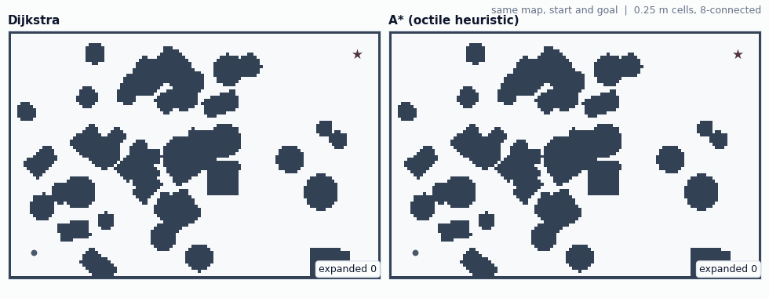
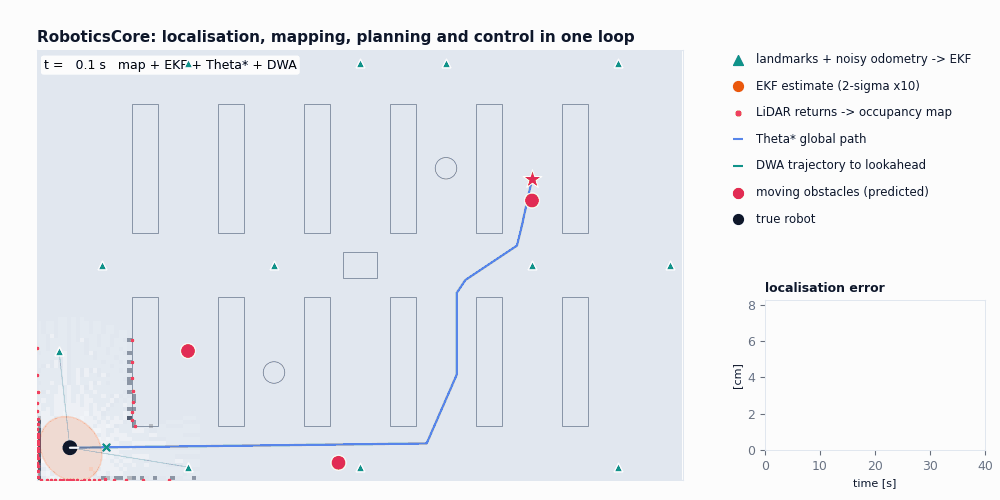

# Grid search: BFS, Dijkstra, A*, weighted A*, Theta*

Headers: [`include/roboticscore/planning/grid/grid_map.hpp`](../../../include/roboticscore/planning/grid/grid_map.hpp), [`include/roboticscore/planning/grid/grid_search.hpp`](../../../include/roboticscore/planning/grid/grid_search.hpp)

## Purpose

Shortest-path search on a binary occupancy grid (`GridMap`). All five planners use the same
graph (`GridMap::step_cost`), the same validity checks and the same deterministic
tie-breaking, so their path lengths and expansion counts can be compared directly. Theta*
returns any-angle waypoints; the others return cell-to-cell paths.

## Mathematical formulation

The grid is a graph $G=(V,E)$ with one vertex per free cell. Edges connect 4- or 8-neighbours
(`Connectivity::kFour` / `kEight`) with cost, in cell units,

$$
c(u,v)=\begin{cases}1 & \text{orthogonal move}\\ \sqrt{2} & \text{diagonal move, both orthogonally adjacent cells free}\\ \infty & \text{otherwise (blocked, out of bounds, or corner cutting)}\end{cases}
$$

Reported costs are Euclidean path lengths in metres (`path_length`, cell units times the
resolution). Best-first search orders the open list by $f(n)=g(n)+w h(n)$:

| Planner | $h$ | $w$ | Guarantee |
|---|---|---|---|
| BFS | none (FIFO queue) | - | fewest moves, not shortest length |
| Dijkstra | $0$ | 1 | optimal |
| A* | `GridSearchConfig::heuristic` | 1 | optimal if $h$ is admissible |
| Weighted A* | same | $w>1$ | cost $\le w \cdot$ optimum |
| Theta* | Euclidean (always) | `heuristic_weight` | any-angle, not guaranteed optimal |

Heuristics with $\Delta x=\lvert x_a-x_b\rvert$, $\Delta y=\lvert y_a-y_b\rvert$: Manhattan
$\Delta x+\Delta y$, Euclidean $\sqrt{\Delta x^2+\Delta y^2}$, Octile
$\max(\Delta x,\Delta y)+(\sqrt2-1)\min(\Delta x,\Delta y)$, Chebyshev $\max(\Delta x,\Delta y)$.
With 4-connectivity all four are admissible (Manhattan is tightest); with 8-connectivity
Octile is tightest, Euclidean and Chebyshev are admissible and **Manhattan overestimates
diagonal moves**.

Theta* (Nash et al. 2007) adds "path 2": when expanding $s$ with parent $p(s)$, a neighbour
$s'$ may take $p(s)$ as its parent if the segment $p(s)\to s'$ has line of sight:

$$
g(s') \leftarrow \min\big(g(s'),\; g(p(s)) + \lVert p(s)-s' \rVert_2\big).
$$

## Assumptions

- Binary traversability; the robot is a point on the grid, so a disc robot must be handled by
  inflating obstacles first (`GridMap::inflated(radius)`).
- Out-of-bounds cells count as blocked. Start and goal must be free and in bounds.
- Static map during a query (see [D* Lite](dstar_lite.md) for changing maps).

## Algorithm

1. Return `kInvalidStart` / `kInvalidGoal` if an endpoint is blocked or out of bounds.
2. Push the start with $g=0$. Pop the entry with the lowest $(f, h, \text{insertion order})$;
   skip stale entries (closed, or $g$ larger than the stored value).
3. Close the node, report it to the optional `ExpansionObserver`, and stop if it is the goal.
4. For every neighbour with finite step cost that is not closed, compute the candidate
   $g$ (for Theta*, via the parent if `line_of_sight` holds) and push it if it improves.
5. Reconstruct the path from parent pointers; an empty open list gives `kNoPath`.

BFS uses a FIFO queue and marks cells when first discovered.

## Implementation notes

- One shared best-first routine implements Dijkstra (zero heuristic), A*, weighted A* and
  Theta*. The heap uses lazy deletion (duplicates are skipped when popped) and closed nodes
  are never reopened.
- `astar` and `theta_star` throw `std::invalid_argument` if `heuristic_weight < 1`.
- `theta_star` ignores `config.heuristic` and always uses the Euclidean heuristic, the only
  admissible choice for any-angle paths; `heuristic_weight` and `connectivity` still apply.
- `line_of_sight` is an exact Amanatides-Woo traversal between cell centres. A segment that
  passes exactly through a cell corner requires both edge-adjacent cells to be free
  (conservative at corners). `GridPath::cells` of Theta* holds only the turning waypoints.
- BFS ignores the diagonal cost during search but reports `cost` as the metric length.
- `GridPath::expanded` counts nodes removed from the open list and expanded; a second
  counter in `GridPath` records insertions into the open list.
- Verified by tests (`tests/unit/planning/test_grid_search.cpp`, `tests/regression`): step
  costs and corner cutting, inflation radius, a known optimal detour of $3+4\sqrt2$ cells,
  A* = Dijkstra with octile and Euclidean heuristics on random maps, the weighted-A* bound,
  BFS never shorter than Dijkstra, A* never expanding more nodes than Dijkstra, Theta* not
  longer than A* and visible between consecutive waypoints, and golden costs and expansion
  counts on a maze.

## Complexity

With a binary heap: $O(E\log V)$ time and $O(V)$ memory, $V$ = cells, $E \approx kV$
($k=4$ or $8$). BFS is $O(V+E)$. Theta* adds a line-of-sight check per neighbour
considered, $O(\ell)$ cells for a segment of length $\ell$ cells. Each call allocates
per-cell arrays of size $V$.

## Configuration

`GridSearchConfig` (used by `astar` and `theta_star`; `dijkstra` and `breadth_first_search`
take only a `Connectivity`, default `kEight`):

| Field | Default | Meaning |
|---|---|---|
| `connectivity` | `Connectivity::kEight` | 4- or 8-neighbourhood |
| `heuristic` | `Heuristic::kOctile` | `kZero`, `kManhattan`, `kEuclidean`, `kOctile`, `kChebyshev` (ignored by Theta*) |
| `heuristic_weight` | `1.0` | $w$; values $>1$ give weighted A* |

## Example

```cpp
#include "roboticscore/planning/grid/grid_search.hpp"

using namespace roboticscore;
using namespace roboticscore::planning;

GridMap map(GridSpec(80, 60, 0.25));            // 20 m x 15 m, 0.25 m cells
for (int y = 0; y < 45; ++y) map.set_blocked({40, y}, true);
const GridMap cspace = map.inflated(0.3);        // disc robot of radius 0.3 m

GridSearchConfig cfg;                            // 8-connected, octile, w = 1
const GridPath a = astar(cspace, {5, 10}, {75, 10}, cfg);
cfg.heuristic_weight = 2.0;
const GridPath w = astar(cspace, {5, 10}, {75, 10}, cfg);   // cost <= 2 * a.cost
const GridPath t = theta_star(cspace, {5, 10}, {75, 10});
if (a.found()) {
  const std::vector<Vec2> waypoints = to_world(cspace.spec(), a.cells);
}
```



Dijkstra vs A* expansion and the Theta* any-angle path. Reproduce with
`python scripts/render/render_astar.py` (runs the `roboticscore_demo` executable, which must be
built first).



Integrated mobile robot using Theta* as its global planner, followed by DWA
(`python scripts/render/render_hero.py`).

## Benchmark

From [docs/benchmarks/README.md](../../benchmarks/README.md): 8-connected, 0.25 m cells,
obstacles inflated by 0.3 m, no corner cutting.

| Scenario | Planner | Time [ms] | Path length [m] | Expanded nodes |
|---|---|---:|---:|---:|
| cluttered | Dijkstra | 0.551 | 34.30 | 6,490 |
| cluttered | A* | 0.377 | 34.30 | 1,520 |
| cluttered | Weighted A* (w=2) | 0.080 | 37.68 | 243 |
| cluttered | Theta* | 0.565 | 32.73 | 1,449 |
| urban grid | BFS | 0.451 | 62.48 | 14,512 |
| urban grid | A* | 1.588 | 62.48 | 7,108 |
| urban grid | Weighted A* (w=2) | 0.088 | 62.48 | 424 |
| urban grid | Theta* | 3.074 | 58.34 | 6,537 |

Microbenchmark `BM_AStarCluttered`: 312.4 us real time, 307.7 us CPU time (median of 5).
Fewer expansions do not always mean less time: in the maze scenario BFS (0.076 ms) is faster
than A* (0.189 ms) despite expanding more nodes.

## Known limitations

- Manhattan is inadmissible with 8-connectivity; A* may then return suboptimal paths.
- BFS minimises the number of moves, not length.
- Theta* is not optimal: only the parent of the expanded node is tested for line of sight,
  and closed nodes are not reopened. It is shorter than A* in the benchmarks but not
  guaranteed to find the shortest any-angle path.
- Weighted A* trades path length for fewer expansions (cluttered: 37.68 m vs 34.30 m).
- Paths are shortest, not safest: they hug inflated obstacles (see the clearance column of the
  benchmark report). Use [path smoothing](path_smoothing.md) or a larger inflation radius.
- Binary costs only; no traversal cost maps. Resolution limits path quality and narrow gaps
  can disappear after inflation.

## References

- E. W. Dijkstra, "A note on two problems in connexion with graphs", Numerische Mathematik, 1959.
- P. E. Hart, N. J. Nilsson, B. Raphael, "A formal basis for the heuristic determination of minimum cost paths", IEEE Transactions on Systems Science and Cybernetics, 1968.
- A. Nash, K. Daniel, S. Koenig, A. Felner, "Theta*: Any-angle path planning on grids", AAAI, 2007.
- S. M. LaValle, "Planning Algorithms", Cambridge University Press, 2006.
