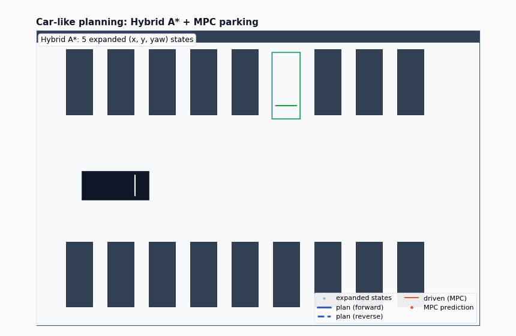

# Hybrid A* and Reeds-Shepp paths

Headers: [`include/roboticscore/planning/kinodynamic/hybrid_astar.hpp`](../../../include/roboticscore/planning/kinodynamic/hybrid_astar.hpp), [`include/roboticscore/planning/kinodynamic/reeds_shepp.hpp`](../../../include/roboticscore/planning/kinodynamic/reeds_shepp.hpp), vehicle model [`include/roboticscore/models/bicycle.hpp`](../../../include/roboticscore/models/bicycle.hpp)

## Purpose

Kinematically feasible paths for car-like vehicles that can drive forwards and backwards,
e.g. parking manoeuvres. Hybrid A* searches over a discretised $(x, y, \psi)$ grid while
every node keeps its continuous pose, so the output is a sequence of exact bicycle arcs that
respects the minimum turning radius. Reeds-Shepp paths give the obstacle-free optimum used as
heuristic and as the final "analytic expansion" onto the goal pose.

## Mathematical formulation

**Vehicle.** Kinematic bicycle with the reference point at the rear axle, wheelbase $L$ and
steering angle $\lvert\delta\rvert\le\delta_\text{max}$:

$$
\dot x=v\cos\psi,\quad \dot y=v\sin\psi,\quad \dot\psi=\frac{v\tan\delta}{L},\qquad
\kappa(\delta)=\frac{\tan\delta}{L},\quad R_\text{min}=\frac{L}{\tan\delta_\text{max}}.
$$

The body is the rectangle `VehicleFootprint` (length, width, rear overhang) attached to the
rear-axle pose.

**Reeds-Shepp.** The shortest path between two poses for a car with turning radius $R$ that
may reverse is one of 48 words of left/right arcs (L, R) and straights (S) with at most two
reversals. `reeds_shepp_shortest` evaluates the closed-form solutions of the families CSC,
CCC, CCCC, CCSC and CCSCC with their time-flip, reflection and backwards symmetries. Segment
lengths are signed (negative = reverse) and expressed in units of $R$; the path length is
$R\sum_i\lvert l_i\rvert$.

**Successors.** From a node with pose $q$, Hybrid A* applies each steering angle
$\delta_i=-\delta_\text{max}+2\delta_\text{max} i/(n-1)$, $i=0,\dots,n-1$ (`steering_samples`),
in forward and, if allowed, reverse gear, for arc length $l$ (`step_length`). The motion cost is

$$
c = l\cdot\begin{cases}1 & \text{forward}\\ p_\text{rev} & \text{reverse}\end{cases}
+ p_\text{steer}\lvert\delta\rvert\,l + p_{\Delta\text{steer}}\lvert\delta-\delta_\text{parent}\rvert
+ \begin{cases}p_\text{gear} & \text{gear change}\\ 0 & \text{otherwise.}\end{cases}
$$

The gear-switch penalty is not charged on the first primitive from the start, and
$\delta_\text{parent}=0$ at the start.

**Heuristic.** $h(q)=\max\big(\ell_\text{RS}(q, q_\text{goal}; R_\text{min}),\ d_\text{2D}(q)\big)$,
where $\ell_\text{RS}$ respects kinematics but ignores obstacles, and $d_\text{2D}$ is an
8-connected grid Dijkstra distance to the goal that respects obstacles but ignores kinematics.

## Assumptions

- Static `Environment2D`; collision checking uses the full footprint polygon.
- Low-speed kinematics (no tyre slip, no speed profile); start and goal are rear-axle poses.
- Steering changes instantaneously between primitives.

## Algorithm

1. Reject if the footprint at start or goal collides. Build the 2D heuristic grid
   (`xy_resolution`), blocking cells closer than $0.95\min(\text{width}/2,\ \text{rear overhang})$
   to an obstacle; that disc always lies inside the body, so no feasible state is removed.
2. Pop the node with the lowest $f=g+h$ (ties by insertion order). Its $(x, y, \psi)$ cell is
   closed; later nodes falling into a closed cell are discarded.
3. Analytic expansion: every `analytic_expansion_interval` expansions, or whenever the
   Reeds-Shepp shot is shorter than $3l$, sample the shot every `collision_step` metres; if all
   footprints are free, the path is complete and ends exactly on the goal pose.
4. Otherwise simulate each primitive in sub-steps of at most `collision_step`, checking the
   footprint after each, and push successors whose $g$ improves the best $g$ stored for their cell.
5. Reconstruct by re-simulating the primitives from the start and append the shot.

## Implementation notes

- Footprint checks first accept poses whose bounding disc has positive clearance, and run the
  exact polygon test only otherwise (`pose_free`).
- `HybridAStarResult::cost` is the search cost plus the shot's length, with its reverse
  parts weighted by `reverse_penalty`; steering and gear penalties are not applied to the shot.
  `length` is the driven distance, `gear_switches` counts direction changes along the whole path,
  `path` holds `DirectedPose` samples (pose, direction, signed curvature).
- `HybridAStar` stores a reference to the environment, which must outlive the planner.
- Every Reeds-Shepp candidate is verified by integrating it before it can be selected.
- Verified by tests (`tests/unit/planning/test_kinodynamic.cpp`, `tests/regression`):
  Reeds-Shepp straight, reverse and quarter-circle lengths; a sideways shift uses a reversal;
  on 400 random pose pairs the path reaches the goal, has symmetric length, is not shorter
  than the Euclidean distance, has at most two reversals and is the minimum over all
  candidates. Hybrid A* parks in a free slot, ends on the goal pose, keeps every sample
  collision free with $\lvert\kappa\rvert\le 1/R_\text{min}$ and spacing $\le$ `collision_step`,
  reports cost $\ge$ length, is deterministic, and rejects a goal overlapping a parked car;
  golden values pin length, cost, gear switches and expansions on the parking scenario.

## Complexity

The 2D heuristic is $O(C\log C)$ for $C$ grid cells, computed once per `plan` call. Each
expansion simulates up to $2n$ primitives with $\lceil l/\text{collision step}\rceil$ footprint
checks of cost $O(M)$ ($M$ obstacle primitives) and evaluates one closed-form Reeds-Shepp
heuristic per successor. Expansions are capped by `max_expansions`; memory is
$O(n_x n_y n_\psi)$ for the per-cell bookkeeping.

## Configuration

`HybridAStarConfig`:

| Field | Default | Meaning |
|---|---|---|
| `xy_resolution` | `0.5` | cell size for pruning and the 2D heuristic [m] |
| `yaw_resolution` | `0.0872664626` | heading bin size [rad] (5 degrees) |
| `step_length` | `1.2` | arc length $l$ of one primitive [m]; must exceed `xy_resolution` |
| `steering_samples` | `5` | odd number $n\ge3$ of steering angles in $[-\delta_\text{max},\delta_\text{max}]$ |
| `allow_reverse` | `true` | expand reverse primitives |
| `reverse_penalty` | `2.0` | $p_\text{rev}\ge1$ |
| `gear_switch_penalty` | `6.0` | $p_\text{gear}$ [m-equivalent] |
| `steer_penalty` | `0.2` | $p_\text{steer}$ |
| `steer_change_penalty` | `0.5` | $p_{\Delta\text{steer}}$ |
| `collision_step` | `0.25` | pose spacing for footprint checks [m] |
| `analytic_expansion_interval` | `5` | try a Reeds-Shepp shot every N expansions |
| `max_expansions` | `200000` | search budget |

Vehicle: `models::BicycleParams` (`wheelbase` 2.7 m, `max_steer` 0.6 rad, `max_speed`
15 m/s, `max_accel` 3 m/s²) and `models::VehicleFootprint` (`length` 4.5 m, `width` 1.9 m,
`rear_overhang` 0.9 m). Invalid values throw `std::invalid_argument`.

## Example

```cpp
#include "roboticscore/planning/kinodynamic/hybrid_astar.hpp"

using namespace roboticscore;
using namespace roboticscore::planning;

geometry::Environment2D env({{0.0, 0.0}, {40.0, 30.0}});
env.add_obstacle(geometry::Polygon::rectangle({20.0, 12.0}, 4.5, 1.9));  // parked car

const models::BicycleParams vehicle{2.7, 0.6, 5.0, 2.0};
const models::VehicleFootprint footprint{4.5, 1.9, 0.9};
const HybridAStar planner(env, vehicle, footprint);  // default HybridAStarConfig
const HybridAStarResult r =
    planner.plan(geometry::Pose2(5.0, 5.0, 0.0), geometry::Pose2(30.0, 20.0, 1.5708));
if (r.found) { /* r.path, r.length, r.gear_switches */ }

const ReedsSheppPath rs = reeds_shepp_shortest({0, 0, 0}, {0, 1.0, 0}, 1.0);
const std::vector<DirectedPose> samples = sample_reeds_shepp({0, 0, 0}, rs, 0.1);
```



Hybrid A* parking plan tracked by an MPC controller. Reproduce with
`python scripts/render/render_parking.py` (runs the `roboticscore_demo` executable, which must
be built first).

## Benchmark

Hybrid A* has no scenario entry in [docs/benchmarks/README.md](../../benchmarks/README.md). The
microbenchmark `BM_ReedsSheppShortest` (one shortest-path query, used for every heuristic
evaluation) measures 3,355.6 ns real time and 3,264.5 ns CPU time (median of 5).

## Known limitations

- Not optimal and only weakly resolution complete: pruning by $(x,y,\psi)$ cell discards
  states a finer search would keep, closed cells are never reopened, and the grid heuristic can
  overestimate, so the heuristic is not guaranteed admissible.
- The search ends at the first collision-free analytic shot, without comparing alternatives.
- `allow_reverse = false` restricts only the search primitives; the final Reeds-Shepp shot
  may still contain reverse segments.
- Collision checks are sampled every `collision_step`, not swept; a small obstacle touched
  only by the body between two samples can be missed.
- The path is not smoothed and steering is piecewise constant, so curvature jumps between
  primitives; a tracking controller (MPC in the parking demo) must absorb them.
- The Reeds-Shepp heuristic is evaluated once per successor, so its cost (see the
  microbenchmark above) is multiplied by the branching factor $2n$.

## References

- D. Dolgov, S. Thrun, M. Montemerlo, J. Diebel, "Path planning for autonomous vehicles in unknown semi-structured environments", International Journal of Robotics Research, 2010.
- J. A. Reeds, L. A. Shepp, "Optimal paths for a car that goes both forwards and backwards", Pacific Journal of Mathematics, 1990.
- P. E. Hart, N. J. Nilsson, B. Raphael, "A formal basis for the heuristic determination of minimum cost paths", IEEE Transactions on Systems Science and Cybernetics, 1968.
- S. M. LaValle, "Planning Algorithms", Cambridge University Press, 2006.
