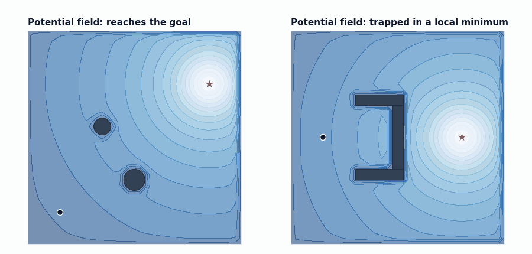
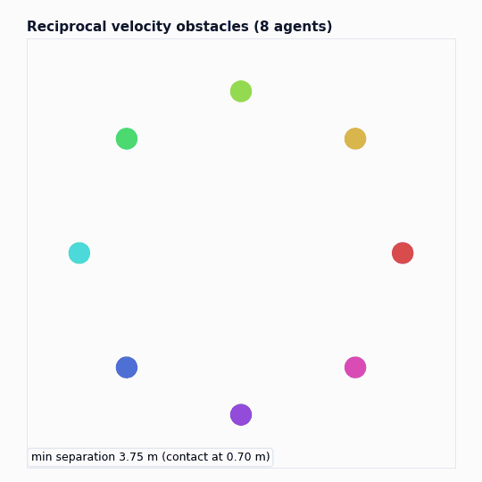
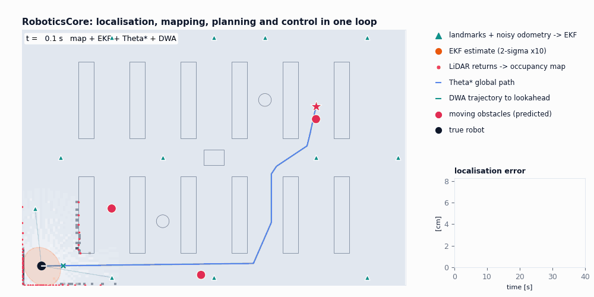

# Local planners: DWA, potential fields, velocity obstacles (RVO)

Headers: [`include/roboticscore/planning/local/dwa.hpp`](../../../include/roboticscore/planning/local/dwa.hpp), [`include/roboticscore/planning/local/potential_field.hpp`](../../../include/roboticscore/planning/local/potential_field.hpp), [`include/roboticscore/planning/local/velocity_obstacles.hpp`](../../../include/roboticscore/planning/local/velocity_obstacles.hpp)

## Purpose

Reactive, per-cycle motion selection near obstacles. The **Dynamic Window Approach** chooses a
unicycle command $(v,\omega)$ that respects acceleration limits; **artificial potential
fields** follow the negative gradient of an attractive-plus-repulsive potential (an
educational baseline); **velocity obstacles** select a collision-free velocity among moving
disc agents, with the reciprocal variant (RVO) for agents that also avoid. None has global
knowledge; they are normally driven by waypoints from a global planner.

## Mathematical formulation

### DWA

Search space: velocity limits $\cap$ dynamic window
$[v_c-a T,\ v_c+a T]\times[\omega_c-\alpha T,\ \omega_c+\alpha T]$ around the current
command $(v_c,\omega_c)$ ($a$ = `max_accel`, $\alpha$ = `max_yaw_accel`, $T$ = `control_period`)
$\cap$ admissible velocities $v\le\sqrt{2 \mathrm{dist}(v,\omega) a_\text{max}}$, where
$\mathrm{dist}$ is the free distance along the arc of curvature
$\kappa=\omega/\max(\lvert v\rvert, v_\text{floor})$ in the driving direction, capped at
$d_\text{cap}$ (`clearance_cap`). Each command is rolled out for `predict_time` and scored

$$
G(v,\omega)=w_h\Big(1-\frac{\lvert\theta_\text{err}\rvert}{\pi}\Big)+w_c\,\frac{\mathrm{dist}(v,\omega)}{d_\text{cap}}+w_v\,\frac{v}{v_\text{max}},
$$

with $\theta_\text{err}$ the angle between the final rollout heading and the direction from
the final rollout position to the goal. Two documented deviations from Fox et al.: the terms
use these **fixed physical scales** instead of per-cycle min-max normalisation (which made the
robot alternate between nearly identical commands), and the **curvature uses
$\max(\lvert v\rvert, v_\text{floor})$**, so near-stationary commands are not evaluated as
tight, obstacle-free circles. Moving obstacles are extrapolated at constant velocity along the
rollout (an extension of the static original).

### Potential field (Khatib 1986)

With $d=\lVert p-g\rVert$, clearance $\rho(p)$, influence distance $\rho_0$ and conic
threshold $d^{\ast}$:

$$
U_\text{att}=\begin{cases}\tfrac12 k_\text{att}d^2 & d\le d^{\ast}\\ k_\text{att}d^{\ast}d-\tfrac12k_\text{att}{d^{\ast}}^2 & \text{otherwise}\end{cases}
\qquad
U_\text{rep}=\begin{cases}\tfrac12k_\text{rep}\big(\tfrac1\rho-\tfrac1{\rho_0}\big)^2 & \rho\le\rho_0\\ 0 & \text{otherwise}\end{cases}
$$

The robot moves a fixed `step_size` along the normalised force $F=-\nabla(U_\text{att}+U_\text{rep})$,
where $-\nabla U_\text{rep}=k_\text{rep}(1/\rho-1/\rho_0)\rho^{-2}\nabla\rho$.

### Velocity obstacles

For agent $A$ and neighbour $B$ with combined radius $r=r_A+r_B+$ `safety_margin`:

$$
VO_\tau=\lbrace v \mid \exists\,t\in[0,\tau]:\ \lVert p_B-p_A-(v-v_B)\,t\rVert<r\rbrace,\qquad
RVO=\lbrace v \mid 2v-v_A\in VO_\tau\rbrace .
$$

$v\in VO_\tau$ is tested via the time to collision, the smallest root $t\ge0$ of
$\lVert p_B-p_A-(v-v_B)t\rVert=r$. Without a free candidate the penalty
$w/t_c+\lVert v-\tilde v_\text{pref}\rVert$ (van den Berg et al. 2008) is minimised, where
$\tilde v_\text{pref}$ is the preferred velocity rotated by `side_bias` (see Algorithm).

## Assumptions

- DWA: unicycle robot of radius `robot_radius`, exact constant-input arcs, static
  `Environment2D` plus `MovingObstacle` discs with constant velocity.
- Potential field: point robot ($\rho$ is `Environment2D::clearance`, nearest obstacle or wall).
- VO/RVO: holonomic disc agents with known positions and velocities; RVO assumes the neighbour
  applies the same policy (`VoNeighbor::reciprocal`).

## Algorithm

- **DWA** (`dwa_plan`): sample a `speed_samples` x `yaw_rate_samples` grid over the window;
  roll out each command; mark it admissible if the rollout clearance stays positive and
  $v^2/(2a_\text{max})\le\mathrm{dist}$; return the admissible command with the highest $G$.
  If none is admissible, return a zero command, or with `escape_when_blocked` the rollout with
  the largest worst-case clearance (`valid` stays false).
- **Potential field** (`potential_field_plan`): step along $F/\lVert F\rVert$ until the goal
  is within `goal_tolerance` (`kReachedGoal`), $\lVert F\rVert<10^{-9}$ or net displacement
  over `stall_window` iterations is below `stall_distance` (`kLocalMinimum`), clearance
  $\le0$ (`kCollision`), or `max_iterations` (`kMaxIterations`).
- **VO/RVO** (`select_velocity`): clamp $v_\text{pref}$ to `max_speed`; if it is collision free
  within $\tau$, return it unchanged. Otherwise rotate it by `side_bias` (counter-clockwise for
  positive values), evaluate it, the zero velocity and a polar grid of `speed_samples` x
  `heading_samples` velocities, and return the free candidate closest to the rotated
  preference, else the minimum-penalty candidate.

## Implementation notes

- DWA: the free arc distance is measured in 5 cm steps against obstacles at their current
  positions; only the rollout clearance is time-aware. Each `DwaCandidate` (rollout,
  clearance, free distance, heading, score) is returned for visualisation.
- Potential field: $\nabla\rho$ uses central differences ($h=10^{-5}$); $\rho$ includes the
  workspace walls.
- RVO uses $2v-v_A$ in place of $v$ for neighbours with `reciprocal = true`, plain VO otherwise.
  The symmetric "swap" deadlock arises because equal velocities are always outside every RVO;
  the `side_bias` rotation breaks it while leaving unobstructed agents on their exact preference.
- Verified by tests (`tests/unit/planning/test_local_planners.cpp`): DWA candidates stay in
  the dynamic window, an obstacle is passed without selecting a colliding rollout, and no
  admissible rollout leaves a cage; the potential-field force equals the numerical negative
  gradient, open space is solved and a U-shaped obstacle gives `kLocalMinimum`; time to
  collision is analytic; six reciprocal agents swap across a circle without contact.

## Complexity

- DWA: $N_vN_\omega (T_p/\Delta t + d_\text{cap}/0.05)$ clearance queries per cycle, each
  $O(M)$ for $M$ obstacle primitives plus moving obstacles.
- Potential field: $O(M)$ per iteration (a few clearance queries), up to `max_iterations`.
- VO/RVO: $(2+N_sN_h)$ candidates times $K$ neighbours per call.

## Configuration

`DwaConfig`: `max_speed` 1.0, `min_speed` 0.0 (negative allows reversing), `max_yaw_rate`
1.5, `max_accel` 1.0, `max_yaw_accel` 3.0, `control_period` 0.1, `predict_time` 2.0,
`rollout_dt` 0.1, `speed_samples` 11, `yaw_rate_samples` 21, `heading_weight` 0.8,
`clearance_weight` 0.4, `velocity_weight` 0.2, `robot_radius` 0.3, `clearance_cap` 2.0,
`curvature_speed_floor` 0.25, `escape_when_blocked` false.

`PotentialFieldConfig`: `attractive_gain` 1.0, `repulsive_gain` 2.0, `influence_distance`
($\rho_0$) 2.0, `conic_threshold` ($d^{\ast}$) 3.0, `step_size` 0.05, `goal_tolerance` 0.2,
`max_iterations` 4000, `stall_window` 200, `stall_distance` 0.3.

`VelocityObstacleConfig`: `max_speed` 1.0, `time_horizon` ($\tau$) 4.0, `speed_samples` 8,
`heading_samples` 48, `safety_margin` 0.05, `penalty_weight` ($w$) 1.0, `side_bias` 0.14 rad.

Units are SI (m, s, rad). Invalid values throw `std::invalid_argument`.

## Example

```cpp
#include "roboticscore/planning/local/dwa.hpp"
#include "roboticscore/planning/local/potential_field.hpp"
#include "roboticscore/planning/local/velocity_obstacles.hpp"

using namespace roboticscore;
using namespace roboticscore::planning;

geometry::Environment2D env({{0.0, 0.0}, {20.0, 20.0}});
env.add_obstacle(geometry::Circle{{4.0, 10.0}, 0.8});

DwaConfig dwa;                                   // one control cycle
geometry::Pose2 pose(2.0, 10.0, 0.0);
models::UnicycleInput vel{0.0, 0.0};
const DwaResult d = dwa_plan(pose, vel, Vec2(18.0, 10.0), env, {}, dwa);
if (d.valid) vel = d.command;
pose = models::Unicycle::step(pose, vel, dwa.control_period);

const PotentialFieldResult pf =
    potential_field_plan(env, Vec2(1.0, 12.0), Vec2(18.0, 10.0), PotentialFieldConfig{});

const std::vector<VoNeighbor> others = {{Vec2(4.0, 0.0), Vec2(-1.0, 0.0), 0.3, true}};
const VelocitySelection v = select_velocity(Vec2(0.0, 0.0), Vec2(1.0, 0.0), 0.3,
                                            Vec2(1.0, 0.0), others, VelocityObstacleConfig{});
```



Potential field: one run reaching the goal and one trapped in a local minimum
(`python scripts/render/render_potential_field.py`).



Eight RVO agents swapping places (`python scripts/render/render_rvo.py`).



Integrated mobile robot with EKF localisation, LiDAR mapping, Theta* global planning and DWA
(`python scripts/render/render_hero.py`). The render scripts run the `roboticscore_demo`
executable, which must be built first.

## Benchmark

[docs/benchmarks/README.md](../../benchmarks/README.md) contains no measurements for DWA,
potential fields or velocity obstacles.

## Known limitations

- **DWA** is purely local and can be trapped by concave obstacles (local minima); the heading
  term rewards pointing at the goal, not progress around obstacles. Fixed scales mean the
  weights must be retuned if speeds or `clearance_cap` change. Moving obstacles are predicted
  at constant velocity only.
- **Potential fields** stop in local minima where attraction and repulsion cancel (the
  U-shaped test and the demo show it), oscillate in narrow corridors, may not reach goals near
  obstacles, and cannot pass between closely spaced obstacles (Koren & Borenstein 1991).
  Repulsion comes from the nearest obstacle only.
- **RVO** symmetric scenarios can deadlock; `side_bias` mitigates it by a consistent rotation
  but trades exact preference tracking when in conflict. Selection is sampled, so the result
  is only as fine as the polar grid; if no free sample exists the penalty choice may still
  collide within $\tau$. Reciprocity is assumed, not enforced. This is **not ORCA**: there are no
  half-plane constraints and no linear program.

## References

- D. Fox, W. Burgard, S. Thrun, "The dynamic window approach to collision avoidance", IEEE Robotics & Automation Magazine, 1997.
- O. Khatib, "Real-time obstacle avoidance for manipulators and mobile robots", International Journal of Robotics Research, 1986.
- Y. Koren, J. Borenstein, "Potential field methods and their inherent limitations for mobile robot navigation", IEEE International Conference on Robotics and Automation (ICRA), 1991.
- P. Fiorini, Z. Shiller, "Motion planning in dynamic environments using velocity obstacles", International Journal of Robotics Research, 1998.
- J. van den Berg, M. Lin, D. Manocha, "Reciprocal velocity obstacles for real-time multi-agent navigation", IEEE International Conference on Robotics and Automation (ICRA), 2008.
