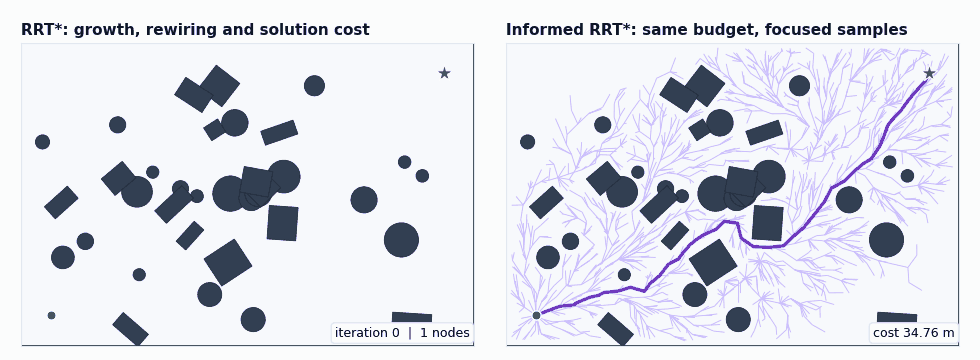

# Sampling-based planners: PRM, RRT, RRT-Connect, RRT*, Informed RRT*

Header: [`include/roboticscore/planning/sampling/sampling_planners.hpp`](../../../include/roboticscore/planning/sampling/sampling_planners.hpp)

## Purpose

Geometric path planning in a continuous 2D workspace (`geometry::Environment2D`) for a disc
robot, without discretising the free space. RRT and RRT-Connect return a first feasible path
quickly; RRT* and Informed RRT* keep improving it towards the optimum; PRM builds a roadmap
and searches it with Dijkstra.

## Mathematical formulation

Common steering function with step $\eta$ (`step_size`):

$$
\mathrm{steer}(x,y)=\begin{cases}y & \lVert y-x\rVert\le\eta\\ x+\eta\,\dfrac{y-x}{\lVert y-x\rVert} & \text{otherwise.}\end{cases}
$$

An edge is valid if the disc of radius `robot_radius` swept along it is collision free
(`Environment2D::segment_free`). Path cost is Euclidean length.

**RRT\*** (Karaman & Frazzoli 2011). For a new vertex $x_\text{new}$ with $n=\lvert V\rvert+1$:

$$
r_n=\min\!\left(\gamma\left(\frac{\log n}{n}\right)^{1/2},\ \eta\right),\qquad
\gamma = f_\text{rewire}\cdot 2\sqrt{1+\tfrac12}\,\sqrt{\mu/\pi},
$$

with $f_\text{rewire}$ = `rewire_factor` and $\mu$ the area of the sampling box (the
workspace shrunk by the robot radius), an upper bound of the free-space measure. The parent
minimises $c(x)+\lVert x-x_\text{new}\rVert$ over collision-free $x$ in
$X_\text{near}=\lbrace x\in V : \lVert x-x_\text{new}\rVert\le r_n\rbrace$; each
$x\in X_\text{near}$ is then rewired through $x_\text{new}$ if
$c(x_\text{new})+\lVert x_\text{new}-x\rVert < c(x)$ and the edge is free.

**Informed RRT\*** (Gammell et al. 2014). Once a solution of cost $c_\text{best}$ exists, only
states that could improve it are sampled:

$$
X_{\hat f}=\lbrace x : \lVert x-x_\text{start}\rVert+\lVert x-x_\text{goal}\rVert\le c_\text{best}\rbrace,
$$

an ellipse with foci at start and goal, semi-axes $r_1=c_\text{best}/2$ and
$r_2=\tfrac12\sqrt{c_\text{best}^2-c_\text{min}^2}$, $c_\text{min}=\lVert x_\text{goal}-x_\text{start}\rVert$.
A uniform sample is $x=x_\text{centre}+R(\varphi) (r_1\rho\cos\theta,\ r_2\rho\sin\theta)$
with $\rho=\sqrt{u_1}$, $\theta=2\pi u_2$ and $R(\varphi)$ the rotation onto the start-goal axis
(`sample_informed_ellipse`).

**PRM** (Kavraki et al. 1996), k-nearest variant: each milestone is connected to its
`prm_neighbors` nearest milestones by collision-free straight edges.

## Assumptions

- Holonomic disc robot in a rectangular 2D workspace with static circles and polygons.
- Start and goal must be collision free; otherwise `found = false` immediately.
- Samples are drawn uniformly from the workspace bounds shrunk by `robot_radius`.

## Algorithm

- **RRT:** sample (the goal with probability `goal_bias`), extend the nearest vertex by
  `steer`, add it if the edge is free; stop at the first vertex within `goal_tolerance` of
  the goal with a free segment to it.
- **RRT-Connect:** two trees (start, goal). Each iteration EXTENDs one tree towards a uniform
  sample, then CONNECTs the other tree greedily towards the new vertex until it is reached or
  trapped; the trees swap roles every iteration. Stops when the trees meet.
- **RRT\*:** as RRT, plus choose-parent and rewiring within $r_n$; descendants of a rewired
  vertex have their costs shifted. All vertices that can reach the goal are re-evaluated each
  iteration because rewiring can lower their cost. Runs the full budget unless
  `stop_at_first_solution` is set.
- **Informed RRT\*:** as RRT*, but after the first solution samples come from $X_{\hat f}$
  (rejecting only samples outside the workspace, up to 100 tries).
- **PRM:** milestones = start, goal and `prm_samples` collision-free uniform samples (at most
  `100 * prm_samples` attempts); k-nearest connections; Dijkstra from start to goal.

## Implementation notes

- A k-d tree (`spatial::KdTree2D`, incremental insertion) answers nearest and radius queries.
- RRT* caches the collision result of each near vertex from choose-parent and reuses it when
  rewiring the same pair.
- If start and goal are within `goal_tolerance` with a free segment, the direct path is
  returned without sampling.
- RRT-Connect samples uniformly, so `goal_bias` has no effect on it. Informed RRT* drops the
  goal bias once a solution exists. PRM ignores `max_iterations`, takes no observer, and
  rebuilds its roadmap on every call; its `tree` holds the milestones (0 = start, 1 = goal).
- `SamplingResult` reports the path, cost, iterations, samples, collision checks, the
  iteration of the first solution and a `cost_history`; the observer receives
  `kNodeAdded`, `kRewired` and `kSolutionImproved` events.
- Results are deterministic for a fixed `seed`.
- Verified by tests (`tests/unit/planning/test_sampling_planners.cpp`): collision-free paths
  from start to goal, tree cost consistency (each cost equals parent cost plus edge length),
  determinism per seed, rewiring never increases a vertex cost, strictly decreasing solution
  costs, RRT* and Informed RRT* within 3% / 2% of the straight line in open space, ellipse
  samples inside the ellipse and centred, PRM through a narrow passage for one seed, and
  correct failure for an enclosed goal or an invalid start.

## Complexity

With $N$ iterations and $M$ obstacle primitives (circles plus polygon edges), one collision
check costs $O(M)$.

- RRT / RRT-Connect: $O(\log n)$ expected nearest-neighbour query plus $O(M)$ per iteration.
- RRT*: radius query $O(\log n + m)$ with $m=O(\log n)$ near vertices, up to $m$ edge checks
  (cached between the two phases), plus subtree cost propagation on each rewire.
- PRM with $N$ milestones and $k$ neighbours: $O(Nk\log N)$ for neighbour queries,
  at most $Nk$ edge checks, $O(Nk\log N)$ for Dijkstra.

## Configuration

`SamplingConfig` (required argument of every planner):

| Field | Default | Used by | Meaning |
|---|---|---|---|
| `step_size` | `1.0` | all but PRM | $\eta$, maximum edge length [m] |
| `goal_bias` | `0.05` | RRT, RRT*, Informed RRT* | probability of sampling the goal |
| `goal_tolerance` | `0.5` | all (PRM: direct start-goal check only) | a vertex this close may connect to the goal [m] |
| `max_iterations` | `5000` | all but PRM | sampling iterations |
| `robot_radius` | `0.0` | all | obstacle inflation [m] |
| `seed` | `1` | all | random seed |
| `stop_at_first_solution` | `false` | RRT*, Informed RRT* | stop instead of optimising |
| `rewire_factor` | `1.1` | RRT*, Informed RRT* | multiplier $f_\text{rewire}$ on $\gamma$ |
| `prm_samples` | `500` | PRM | number of milestones |
| `prm_neighbors` | `10` | PRM | neighbours per milestone |

Invalid values throw `std::invalid_argument`.

## Example

```cpp
#include "roboticscore/planning/sampling/sampling_planners.hpp"

using namespace roboticscore;
using namespace roboticscore::planning;

geometry::Environment2D env({{0.0, 0.0}, {20.0, 15.0}});
env.add_obstacle(geometry::Circle{{10.0, 7.5}, 2.0});
env.add_obstacle(geometry::Polygon::from_aabb({{5.0, 0.0}, {6.0, 10.0}}));

SamplingConfig cfg;
cfg.robot_radius = 0.3;
cfg.max_iterations = 3000;
cfg.seed = 7;
const SamplingResult fast = rrt_connect(env, Vec2(1.0, 1.0), Vec2(18.0, 13.0), cfg);
const SamplingResult best = informed_rrt_star(env, Vec2(1.0, 1.0), Vec2(18.0, 13.0), cfg,
    [](const SamplingEvent& e) {
      if (e.type == SamplingEvent::Type::kSolutionImproved) { /* e.cost */ }
    });
```



RRT* growth and rewiring, compared with Informed RRT*. Reproduce with
`python scripts/render/render_rrt_star.py` (runs the `roboticscore_demo` executable, which must
be built first).

## Benchmark

From [docs/benchmarks/README.md](../../benchmarks/README.md): disc robot of radius 0.3 m, 3,000
iterations, 1 m steering step, PRM with 600 milestones; medians over successful runs of 20 seeds.

**narrow passage**

| Planner | Success rate | Time [ms] | Path length [m] | Nodes | Collision checks |
|---|---:|---:|---:|---:|---:|
| RRT | 1.00 | 0.18 | 20.28 | 162 | 292 |
| RRT-Connect | 1.00 | 0.01 | 17.11 | 10 | 31 |
| RRT* | 1.00 | 10.79 | 16.28 | 2,582 | 10,862 |
| Informed RRT* | 1.00 | 34.82 | 16.12 | 2,752 | 19,133 |
| PRM | 0.75 | 1.68 | 17.04 | 602 | 4,148 |

In open space RRT returns 27.25 m against 22.63 m for Informed RRT* (25.39 ms) and 23.05 m for
RRT* (10.81 ms); in the warehouse scenario RRT* and Informed RRT* reach 30.52 m and 30.00 m.

## Known limitations

- PRM's fixed roadmap can miss narrow passages: 0.75 success rate in the narrow-passage
  benchmark, where every tree planner succeeds. The roadmap is not reused across calls.
- RRT and RRT-Connect stop at the first solution, which is typically long and jagged; use
  [path smoothing](path_smoothing.md).
- RRT* converges slowly and spends the whole iteration budget; in the benchmark it takes
  10.81 ms vs 0.08 ms for RRT in open space and 9.34 ms vs 0.46 ms in the cluttered map. Informed RRT*
  only helps after a first solution, does not prune the tree, and performs more collision
  checks than RRT* in every benchmark scenario.
- The rewiring radius uses the workspace area as $\mu$, which over-estimates the free space
  and therefore the radius in cluttered maps (more collision checks, not less optimality).
- Only probabilistic completeness: `found = false` after the budget does not prove that no
  path exists.
- Holonomic disc robot only; no kinodynamic constraints (see [Hybrid A*](hybrid_astar.md)).

## References

- L. E. Kavraki, P. Svestka, J.-C. Latombe, M. H. Overmars, "Probabilistic roadmaps for path planning in high-dimensional configuration spaces", IEEE Transactions on Robotics and Automation, 1996.
- S. M. LaValle, "Rapidly-exploring random trees: A new tool for path planning", Technical Report TR 98-11, Computer Science Department, Iowa State University, 1998.
- J. J. Kuffner, S. M. LaValle, "RRT-Connect: An efficient approach to single-query path planning", IEEE International Conference on Robotics and Automation (ICRA), 2000.
- S. Karaman, E. Frazzoli, "Sampling-based algorithms for optimal motion planning", International Journal of Robotics Research, 2011.
- J. D. Gammell, S. S. Srinivasa, T. D. Barfoot, "Informed RRT*: Optimal sampling-based path planning focused via direct sampling of an admissible ellipsoidal heuristic", IEEE/RSJ International Conference on Intelligent Robots and Systems (IROS), 2014.
- J. L. Bentley, "Multidimensional binary search trees used for associative searching", Communications of the ACM, 1975.
- S. M. LaValle, "Planning Algorithms", Cambridge University Press, 2006.
