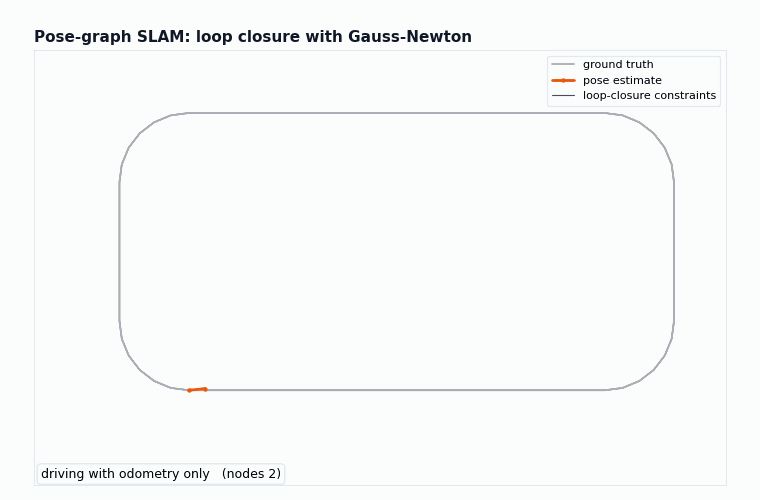

# Pose-graph SLAM (2D)

Header: [`include/roboticscore/slam/pose_graph.hpp`](../../../include/roboticscore/slam/pose_graph.hpp) (trajectory metrics: [`slam/fastslam.hpp`](../../../include/roboticscore/slam/fastslam.hpp))

## Purpose

`slam::PoseGraph2D` is a least-squares back end for graph-based SLAM. Nodes are robot poses
$x_i = (x, y, \theta)$; edges are relative-pose measurements from odometry, scan matching or
loop closures. The optimiser finds the poses that best explain all constraints, which removes accumulated
odometry drift when loops are closed. Gauss-Newton and Levenberg-Marquardt are available.

## Mathematical formulation

An edge $(i, j)$ stores the measurement $Z_{ij} = (t_z, \theta_z) \approx X_i^{-1} X_j$ and an
information matrix $\Omega_{ij}$. Following Grisetti et al., the error is

$$e_{ij} = \Big( R_z^\top \big( R_i^\top (t_j - t_i) - t_z \big),\; \mathrm{wrap}(\theta_j - \theta_i - \theta_z) \Big)$$

The objective is

$$F(x) = \sum_{(i,j)} e_{ij}^\top \Omega_{ij}\, e_{ij} \quad (\text{reported as } \chi^2)$$

The analytic Jacobians are $A_{ij} = \partial e_{ij}/\partial x_i$ and
$B_{ij} = \partial e_{ij}/\partial x_j$:

- $A_{ij}$: translation block $-R_z^\top R_i^\top$, heading column
  $R_z^\top \tfrac{\partial R_i^\top}{\partial \theta_i}(t_j - t_i)$, and $-1$ in the angle
  row;
- $B_{ij}$: translation block $R_z^\top R_i^\top$, and $1$ in the angle row.

Each iteration solves the sparse normal equations over the free nodes:

$$H \Delta x = -b, \qquad H = \sum J_{ij}^\top \Omega_{ij} J_{ij}, \qquad b = \sum J_{ij}^\top \Omega_{ij} e_{ij}$$

Levenberg-Marquardt replaces $H$ by $H + \lambda\,\mathrm{diag}(H)$. It accepts a step if the
gain ratio is positive:

$$\rho = \frac{F(x) - F(x + \Delta x)}{-2 b^\top \Delta x - \Delta x^\top H \Delta x}$$

## Assumptions

- Gaussian edge noise with symmetric positive definite information matrices.
- Edges are correct. Every edge is treated as an inlier, because there are no robust
  kernels.
- The initial guess (usually integrated odometry) lies within the convergence basin.
- At least one node is fixed to remove the gauge freedom. Node 0 is fixed by default.

## Algorithm

1. Assign 3 variables per free node. Fixed nodes contribute to $H$ and $b$ only through
   their neighbours.
2. Repeat up to `max_iterations` times:
   1. Linearise every edge and assemble $H$ (sparse triplets) and $b$.
   2. Gauss-Newton: add $10^{-12} I$, factorise with sparse LDLT, solve, apply, and always
      accept the step.
   3. LM: initialise $\lambda = \lambda_0 \max_k H_{kk}$ once. For up to 20 attempts, solve
      the damped system and compute $\rho$.
      - If $\rho > 0$, accept and set
        $\lambda \leftarrow \lambda \max(\tfrac13, 1 - (2\rho - 1)^3)$.
      - Otherwise restore the poses and set $\lambda \leftarrow \nu\lambda$,
        $\nu \leftarrow 2\nu$.
   4. Stop with `converged = true` when
      $|\chi^2_{\text{old}} - \chi^2_{\text{new}}| \le \text{tol} \cdot \chi^2_{\text{old}}$.
3. Return the $\chi^2$ history and, optionally, the pose history.

## Implementation notes

- **Additive update.** The state update is plain addition on $(x, y, \theta)$ with the
  heading wrapped to $[-\pi, \pi)$, not composition on $SE(2)$. The Jacobians above are taken
  with respect to this parameterisation.
- **Pattern reuse.** `Eigen::SimplicialLDLT` analyses the sparsity pattern once and reuses
  it, refactorising numerically on each iteration and damping attempt.
- **Damping.** LM uses Marquardt's diagonal scaling (floored at 1e-12) and the gain-ratio
  update of $\lambda$ due to Nielsen. If no attempt in an iteration reduces $\chi^2$,
  optimisation stops. It reports `converged` only if $\chi^2$ is already at most 1e-12. A
  failed factorisation returns `converged = false`.
- **Input validation.** `add_edge()` rejects unknown nodes, self-loops and information
  matrices that are not SPD. `optimize()` throws if no node is fixed.
- **Verified by tests** (`tests/unit/slam/test_slam.cpp`, `tests/integration`):
  - analytic edge Jacobians match numerical ones; exact measurements from perturbed
    guesses reach $\chi^2 < 10^{-16}$;
  - on a two-lap loop dataset both methods converge, reduce $\chi^2$ below 5% of its
    initial value, cut ATE below 60% of the odometry ATE, reach a $\chi^2$ no larger than
    that of the true trajectory, and keep the anchor fixed;
  - the loop-SLAM integration pipeline removes drift.

## Complexity

From the header, building $H$ and $b$ costs $O(\text{nnz})$, which is proportional to the
number of edges. The solve is a sparse factorisation whose cost depends on the fill-in. That
fill-in is near linear for chain-like graphs with few loop closures and grows with graph
connectivity. The solver uses the default fill-reducing ordering of
`Eigen::SimplicialLDLT`. LM may refactorise up to
20 times per iteration.

## Configuration

`PoseGraphOptions`:

| Field | Default | Meaning |
|---|---:|---|
| `method` | `kLevenbergMarquardt` | `kGaussNewton` or `kLevenbergMarquardt` |
| `max_iterations` | 50 | Outer iteration limit |
| `relative_tolerance` | 1e-10 | Stop when $\chi^2$ decreases by less than this fraction |
| `initial_lambda` | 1e-4 | LM damping, scaled by the largest diagonal entry of $H$ |
| `record_history` | false | Store all poses after every iteration |

Trajectory metrics (declared in `fastslam.hpp`, formulas in [fastslam.md](fastslam.md)):
`absolute_trajectory_error(estimate, truth, align = true)` is the RMS position error after
an optional least-squares rigid alignment; `relative_pose_error(estimate, truth, delta = 1)`
is the RMS translation error of relative motions over `delta` steps.

`PoseGraphEdge` has the fields `from`, `to`, `measurement` ($Z_{ij} = X_i^{-1}X_j$) and
`information` (default identity). `set_fixed(node, fixed)` changes the gauge anchors.

## Example

```cpp
#include "roboticscore/slam/pose_graph.hpp"

using namespace roboticscore;
using geometry::Pose2;

slam::PoseGraph2D graph;
const Pose2 a(0, 0, 0), b(2, 1, 0.5), c(3, -1, -1.0);
graph.add_node(a);                         // node 0, fixed by default
graph.add_node(Pose2(1.5, 1.4, 0.2));      // perturbed initial guesses
graph.add_node(Pose2(3.3, -0.5, -0.8));
graph.add_edge({0, 1, a.between(b), Mat3::Identity()});   // odometry
graph.add_edge({1, 2, b.between(c), Mat3::Identity()});
graph.add_edge({0, 2, a.between(c), Mat3::Identity()});   // loop closure

slam::PoseGraphOptions options;            // Levenberg-Marquardt by default
const slam::PoseGraphResult r = graph.optimize(options);
// r.converged, r.initial_chi2, r.final_chi2, graph.poses()
```



The animation shows a pose-graph loop closure. Reproduce it with
`python scripts/render/render_pose_graph.py`.

## Benchmark

From [docs/benchmarks/README.md](../../benchmarks/README.md): two laps of a block with
drifting odometry and simulated place recognition, solved with Gauss-Newton (not the
default LM).

| Method | ATE [m] | ATE odometry only [m] | Total time [ms] |
|---|---:|---:|---:|
| Pose graph (Gauss-Newton) | 0.178 | 1.128 | 1.38 |

No Levenberg-Marquardt timing is reported.

## Known limitations

- **No robustness to outliers.** A single false loop closure can distort the whole map.
  Robust kernels and switchable constraints are not provided.
- **Local convergence.** With poor initial headings, Gauss-Newton can diverge because it
  always takes the step. LM is safer but still local.
- **Scope.** 2D poses only: no landmarks, no 3D, no marginal covariances. For large
  problems use a dedicated back end such as g2o, GTSAM or Ceres.
- **Metrics.** `absolute_trajectory_error()` aligns positions only, and
  `relative_pose_error()` measures translation only. Heading errors are not scored.

## References

- G. Grisetti, R. Kümmerle, C. Stachniss, W. Burgard, "A Tutorial on Graph-Based SLAM",
  IEEE Intelligent Transportation Systems Magazine, 2010.
- F. Lu, E. Milios, "Globally Consistent Range Scan Alignment for Environment Mapping",
  Autonomous Robots, 1997.
- K. Levenberg, "A Method for the Solution of Certain Non-Linear Problems in Least
  Squares", Quarterly of Applied Mathematics, 1944.
- D. W. Marquardt, "An Algorithm for Least-Squares Estimation of Nonlinear Parameters",
  Journal of the Society for Industrial and Applied Mathematics, 1963.
