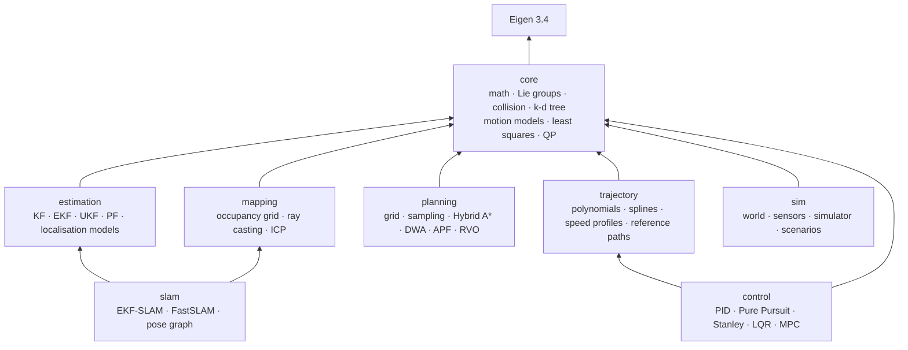
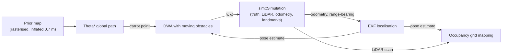

# Architecture

RoboticsCore is a set of C++20 static libraries with one umbrella target. The rationale is in
[ADR 0001](adr/0001-modular-static-libraries.md).

## Modules



| Target | Contents | Depends on |
|---|---|---|
| `RoboticsCore::core` | `core/`, `math/`, `geometry/`, `spatial/`, `models/`, `optimization/` | Eigen |
| `RoboticsCore::estimation` | `estimation/`, `localization/` | core |
| `RoboticsCore::mapping` | `mapping/`, `registration/` | core |
| `RoboticsCore::planning` | `planning/` | core |
| `RoboticsCore::trajectory` | `trajectory/` | core |
| `RoboticsCore::control` | `control/` | core, trajectory |
| `RoboticsCore::slam` | `slam/` | estimation, mapping |
| `RoboticsCore::sim` | `sim/` | core |
| `RoboticsCore::RoboticsCore` | all of the above | |

## Repository layout

```text
include/roboticscore/   public headers, one directory per area
src/                    implementation, mirrors include/
apps/
  pipelines/            end-to-end scenarios shared by demos and integration tests
  demos/                roboticscore_demo: runs a scenario, writes a JSON trace
  benchmarks/           roboticscore_bench: scenario benchmarks, writes JSON results
benchmarks/             Google Benchmark microbenchmarks
tests/                  unit/, numerical/, integration/, regression/ (GoogleTest, CTest labels)
python/roboticscore_viz/ trace rendering, GIF encoding, benchmark report
scripts/                render/, benchmark/, docs/ entry points
configs/                demo configurations and the algorithm registry
docs/                   algorithm pages, mathematics notes, ADRs, assets, benchmark report
examples/               downstream project consuming the installed package
ros2/roboticscore_ros/  optional ROS 2 adapter (separate ament package)
```

## Design conventions

- **Units and frames.** SI units throughout. Planar poses are `geometry::SE2` (alias `Pose2`)
  with yaw in radians, wrapped to [-π, π). Grid cells are `geometry::GridIndex`. A
  `geometry::GridSpec` maps between cells and world coordinates.
- **Value types.** Algorithms are free functions or small classes that own their state. A
  configuration struct with documented defaults is passed by value or by `const&`.
- **Errors.** Contract violations throw `std::invalid_argument`, numerical breakdowns throw
  `NumericalError`, and expected outcomes are reported in result structs
  ([ADR 0002](adr/0002-error-handling.md)).
- **Determinism.** No hidden global state. Every stochastic API takes an explicitly seeded
  `math::Random` ([ADR 0004](adr/0004-determinism.md)).
- **Observability.** Planners and solvers accept optional observers or record histories, for
  example sampling events, ICP iterations and D* Lite expansions. Demos and the visualisation
  read these records; when no observer is attached, nothing is recorded.
- **No I/O in the library.** JSON serialisation of traces and results lives in `apps/` only.

## Data flow of the integrated demo

The mobile-robot pipeline in [`apps/pipelines/hero.cpp`](../apps/pipelines/hero.cpp) combines
most modules in a closed loop:



The global path is planned once on the inflated prior map. DWA tracks a carrot point on that
path, avoids the moving obstacles, and plans from the EKF estimate. The occupancy grid is built
from LiDAR scans at the estimated poses. Its accuracy against the ground-truth raster is
reported, but the planners do not use it.

The simulator ([`sim/simulation.hpp`](../include/roboticscore/sim/simulation.hpp)) uses a fixed
time step and an explicitly seeded generator. A run is therefore repeatable for a given seed
and build; see [ADR 0004](adr/0004-determinism.md) for cross-platform limits.

## Testing strategy

| Suite | CTest label | Purpose |
|---|---|---|
| `tests/unit` | `unit` | API contracts, edge cases, known analytic answers |
| `tests/numerical` | `numerical` | Derivative checks, Lie-group identities, filter consistency, convergence |
| `tests/integration` | `integration` | Closed-loop pipelines reach their goals without collision |
| `tests/regression` | `regression` | Golden values for deterministic planners and solvers |

Run a single suite with `ctest --preset <preset> -L <label>`.
